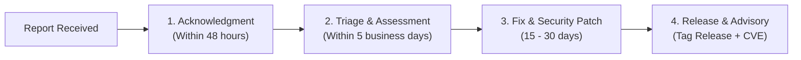

# Security Policy & Vulnerability Disclosure

**Issuing Authority:** Information and Communications Technology Office (ICTO), Municipality of Bayambang  
**Lead Maintainer:** Ricky Bulalakaw, Head, ICTO (`bulalakawr@bayambang.gov.ph`)  
**Package:** `lgu-bayambang-ict-office/lgu-laravel-development-standards`

The Information and Communications Technology Office (ICTO) takes the security of municipal information systems, personal data privacy (RA 10173), and public trust with utmost seriousness. We appreciate the efforts of security researchers and engineers in reporting vulnerabilities responsibly.

---

## 1. Supported Versions

Security updates and patches are actively maintained for the following versions:

| Version | Supported | Status |
| :--- | :---: | :--- |
| **`1.x` / `1.0.x`** | ✅ YES | Actively maintained & supported |
| `< 1.0.0` | ❌ NO | Deprecated / pre-release |

---

## 2. Reporting a Vulnerability

> [!IMPORTANT]
> **Never open a public GitHub issue for an unpatched security vulnerability.**  
> Public issues expose municipal systems and citizen data to malicious exploitation before a patch is available.

Please report security issues using one of the two private channels below:

### Option A: GitHub Private Vulnerability Reporting (Preferred)
1. Navigate to the repository's **[Security Tab](https://github.com/LGU-Bayambang-ICT-Office/LGU-Laravel-Development-Standards/security)**.
2. Under "Reporting a vulnerability", click **Report a vulnerability**.
3. Fill out the private disclosure form detailing:
   * Affected component (e.g., `EncryptedPii`, `OfficeScope`, `AuditActivityObserver`, middleware).
   * Step-by-step reproduction instructions or a minimal Proof of Concept (PoC).
   * Estimated severity (CVSS score) and potential impact (e.g., data spillage, privilege escalation).
4. Submit the report. This opens a private advisory between you and the ICTO engineering team.

### Option B: Direct Confidential Email
If you prefer email or do not have a GitHub account, send your report to:
* **Primary:** `bulalakawr@bayambang.gov.ph` (Ricky Bulalakaw, Head of ICTO)
* **Secondary:** `icto@bayambang.gov.ph` (Municipal ICT Office)
* **Subject Format:** `[SECURITY DISCLOSURE] lgu-laravel-development-standards - <Brief Description>`

---

## 3. Vulnerability Response SLA & Process

Upon receiving a private security disclosure, the ICTO security team follows this timeline:

1. **Initial Acknowledgment:** Within **48 hours**, confirming receipt of the report.
2. **Triage & Validation:** Within **5 business days**, validating the issue, determining severity, and assigning internal engineering resources.
3. **Patch Development:** Developing and testing a fix in a private branch.
4. **Coordinated Release & Advisory:** Deploying a patched release tag on GitHub and Packagist, publishing a formal GitHub Security Advisory, and crediting the researcher.

---

## 4. Scope & Safe Harbor Policy

### In-Scope:
* Vulnerabilities in the core package classes (`Lgu\GovSuite\...`).
* Cryptographic flaws in AES-256 field encryption (`EncryptedPii`) or blind index hashing (`HasPiiHashing`).
* Bypasses in fail-closed departmental isolation (`OfficeScope`).
* Integrity flaws in COA cryptographic audit hash chains (`AuditActivityObserver`).
* Authorization bypasses or privilege escalation in `BaseGovernmentPolicy` or `DisbursementVoucherPolicy`.

### Out-of-Scope:
* Attacks targeting live municipal production servers, municipal networks, or physical offices.
* Denial of Service (DoS / DDoS) attacks.
* Social engineering or phishing targeting municipal employees or citizens.
* Third-party software dependencies (e.g., upstream vulnerabilities in `laravel/framework`), which should be reported to their respective maintainers.

### Safe Harbor (Good Faith Research):
The Municipality of Bayambang and ICTO will **not** pursue civil or criminal legal action under the **Philippine Cybercrime Prevention Act of 2012 (RA 10175)** or the **Data Privacy Act of 2012 (RA 10173)** against researchers who:
* Conduct security research in good faith and without malicious intent.
* Avoid destroying municipal data, accessing real citizen records, or causing service disruptions.
* Adhere to coordinated disclosure and allow reasonable time for a patch before publishing findings.
* Do not demand financial ransom or extortion payments.

---

## 5. Security Best Practices for Implementers

Developers integrating this package into LGU systems must ensure:
1. **Isolated Encryption Keys:** Sourced from `PII_ENCRYPTION_KEY` in `.env`, completely distinct from `APP_KEY`.
2. **Database Triggers Active:** Always deploy `freeze_audit_logs_trigger.sql` in production to prevent out-of-band audit ledger modification.
3. **Fail-Closed Verification:** Regularly test that sessions lacking an `active_office_id` fail closed (`1 = 0`) to prevent cross-office data spillage.

---
*Maintained by the Information and Communications Technology Office (ICTO), Municipality of Bayambang.*
