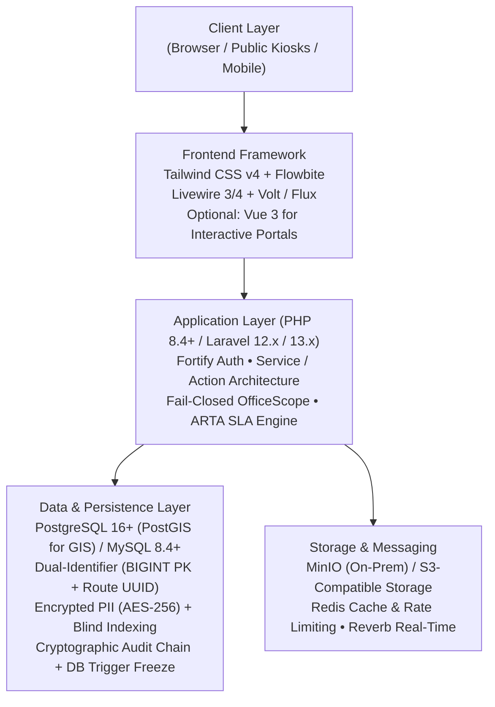
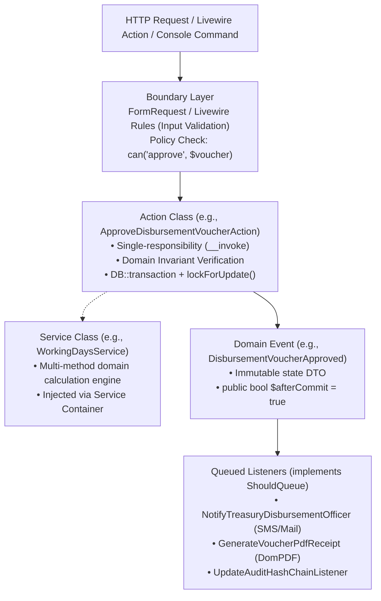
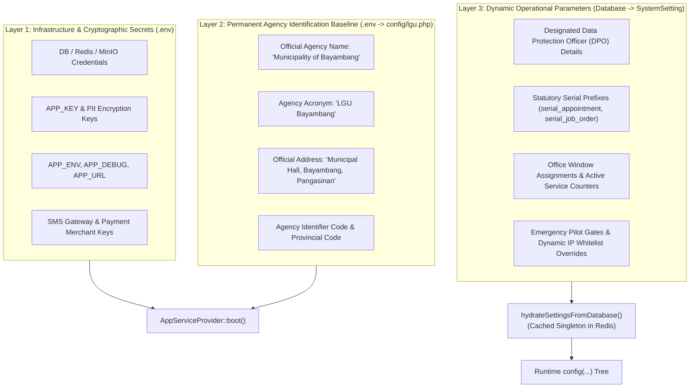
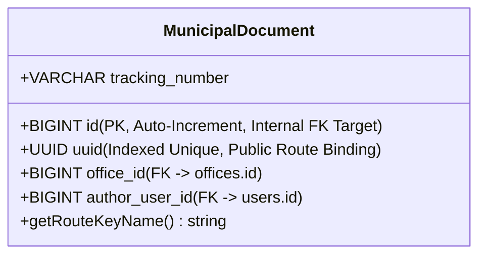
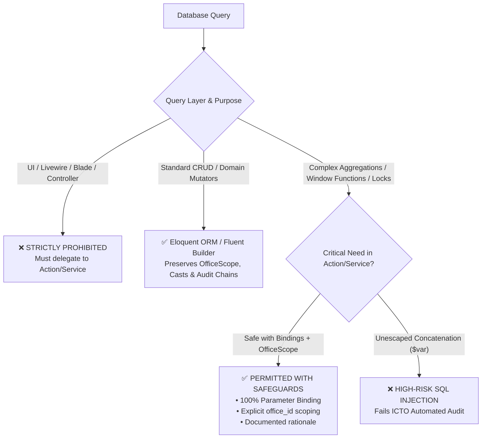
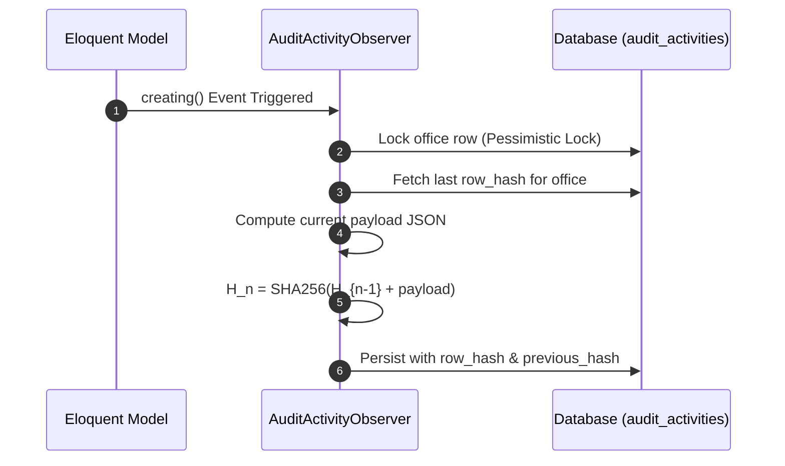
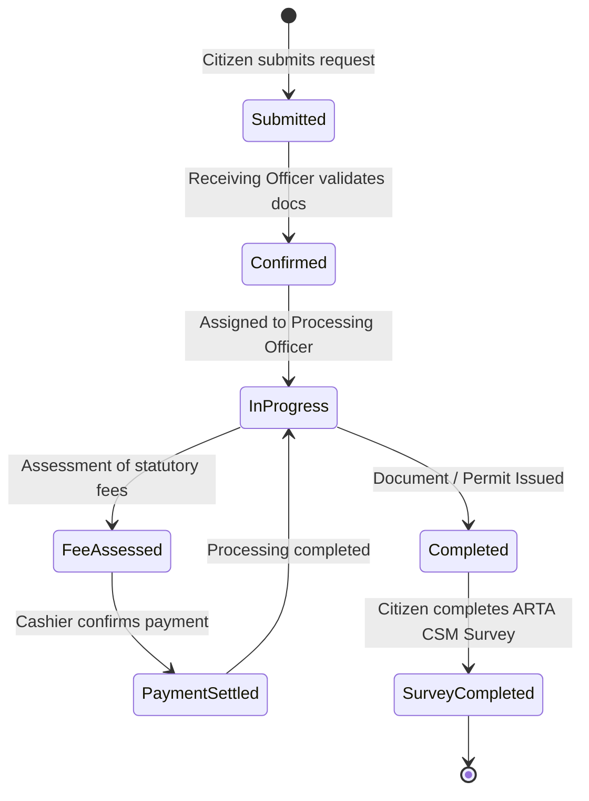
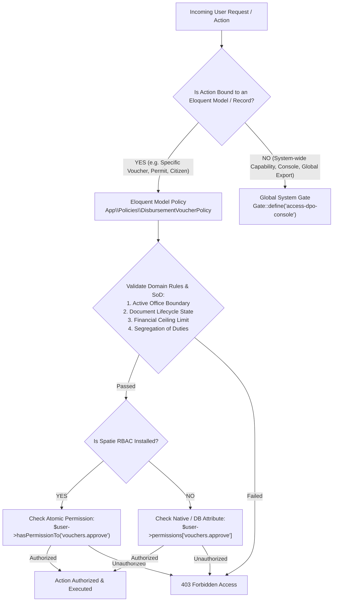
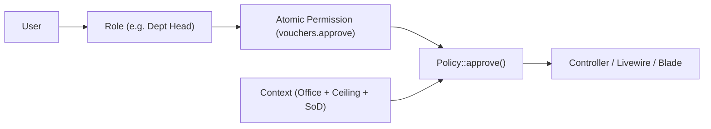

# Local Government Unit (LGU) Laravel Development Standards
## Comprehensive Engineering Handbook & Vendor Governance Standard

**Document Control Reference:** `LGU-ICTO-STD-2026-V1`  
**Issuing Authority:** Information and Communications Technology Office (ICTO), Municipality of Bayambang  
**Contact:** `icto@bayambang.gov.ph`  
**Target Environment:** Modern Laravel (12.x / 13.x), PHP 8.4+, PostgreSQL 16+ / MySQL 8.4+  
**Scope of Authority:** Mandatory for all in-house software engineering teams, contractual technical staff, and external software vendors delivering systems to the Local Government Unit (LGU).

---

## Table of Contents
1. [Executive Mandate & Governance Framework](#1-executive-mandate--governance-framework)
2. [Philippine Statutory, Regulatory & Security Framework Matrix](#2-philippine-statutory--regulatory-compliance-matrix)
   - [2.1 Data Privacy Act of 2012 (RA 10173) & NPC Guidelines](#21-data-privacy-act-of-2012-ra-10173--npc-guidelines)
   - [2.2 ARTA / Ease of Doing Business Act (RA 11032)](#22-arta--ease-of-doing-business-act-ra-11032)
   - [2.3 Commission on Audit (COA) Circulars & Financial Ledgers](#23-commission-on-audit-coa-circulars--financial-ledgers)
   - [2.4 National Archives of the Philippines (NAP) Records Schedules](#24-national-archives-of-the-philippines-nap-records-schedules)
   - [2.5 Civil Service Commission (CSC) Requirements](#25-civil-service-commission-csc-requirements)
   - [2.6 OWASP Top 10:2025 Application Security Framework](#26-owasp-top-102025-application-security-framework)
   - [2.7 Statutory vs. OWASP Top 10 Reconciliation Matrix](#27-statutory-vs-owasp-top-10-reconciliation-matrix)
3. [Standard Technology Stack & Baseline](#3-standard-technology-stack--baseline)
4. [MVC Architecture & Appropriate Livewire Usage](#4-mvc-architecture--appropriate-livewire-usage)
   - [4.1 The Role of Traditional MVC in Enterprise Government Systems](#41-the-role-of-traditional-mvc-in-enterprise-government-systems)
   - [4.2 The Anti-Pattern: Monolithic Livewire Modals for Record Viewing](#42-the-anti-pattern-monolithic-livewire-modals-for-record-viewing)
   - [4.3 The Dedicated Show Route Mandate](#43-the-dedicated-show-route-mandate)
   - [4.4 Allowed Scope for Livewire Modals (The Rule of 3)](#44-allowed-scope-for-livewire-modals-the-rule-of-3)
   - [4.5 URL State Synchronization & Deep-Linking (#[Url])](#45-url-state-synchronization--deep-linking-url)
   - [4.6 Separation of Concerns: Printable Views & Binary Streaming](#46-separation-of-concerns-printable-views--binary-streaming)
   - [4.7 Architectural Rationale, Benefits, and Caveats](#47-architectural-rationale-benefits-and-caveats)
5. [Domain Logic Architecture: Actions, Services & Event-Driven Design](#5-domain-logic-architecture-actions-services--event-driven-design)
   - [5.1 Action Classes: Single-Responsibility Business Mutations](#51-action-classes-single-responsibility-business-mutations)
   - [5.2 Service Classes: Domain Calculations & Aggregate Services](#52-service-classes-domain-calculations--aggregate-services)
   - [5.3 Event-Driven Architecture: Asynchronous Decoupling & afterCommit Safety](#53-event-driven-architecture-asynchronous-decoupling--aftercommit-safety)
   - [5.4 Architectural Decision Matrix: Action vs. Service vs. Event vs. Job](#54-architectural-decision-matrix-action-vs-service-vs-event-vs-job)
   - [5.5 Architectural Rationale, Benefits, and Caveats](#55-architectural-rationale-benefits-and-caveats)
6. [Configuration Architecture & Secrets Management: .env vs. Database Settings](#6-configuration-architecture--secrets-management-env-vs-database-settings)
   - [6.1 The Three-Layer Configuration Hierarchy](#61-the-three-layer-configuration-hierarchy)
   - [6.2 Agency Identification Standard (.env Baseline)](#62-agency-identification-standard-env-baseline)
   - [6.3 Dynamic Settings Hydration: The hydrateIhrisSettings Pattern](#63-dynamic-settings-hydration-the-hydrateihrissettings-pattern)
   - [6.4 Interactive Modification via Laravel Prompts & Artisan Commands](#64-interactive-modification-via-laravel-prompts--artisan-commands)
   - [6.5 Architectural Rationale, Benefits, and Caveats](#65-architectural-rationale-benefits-and-caveats)
7. [Database Design, The Dual-Identifier Standard & Balanced Query Architecture](#7-database-design-the-dual-identifier-standard--balanced-query-architecture)
   - [7.1 The Core Mandate](#71-the-core-mandate)
   - [7.2 Migration Standard](#72-migration-standard)
   - [7.3 Eloquent Model Implementation](#73-eloquent-model-implementation)
   - [7.4 Foreign Key Deletion Rules](#74-foreign-key-deletion-rules)
   - [7.5 Balanced Database Query Architecture & RAW SQL Policy](#75-balanced-database-query-architecture--raw-sql-policy)
   - [7.6 Architectural Rationale, Benefits, and Caveats](#76-architectural-rationale-benefits-and-caveats)
8. [Multi-Office Department Scoping & Data Isolation](#8-multi-office-department-scoping--data-isolation)
9. [Security Engineering, OWASP Top 10 Hardening & Municipal Workstations](#9-security-engineering-owasp-top-10-hardening--municipal-workstations)
   - [9.1 Content Security Policy (CSP) & Vite Nonces](#91-content-security-policy-csp)
   - [9.2 Workstation Session Timeout](#92-workstation-session-timeout)
   - [9.3 Browser Cache Prevention for Sensitive Data](#93-browser-cache-prevention-for-sensitive-data)
   - [9.4 Multi-Factor Authentication (MFA)](#94-multi-factor-authentication-mfa)
   - [9.5 Standard HTTP Security Headers](#95-standard-http-security-headers)
   - [9.6 Cross-Site Scripting (XSS) Prevention & Blade Sanitization](#96-cross-site-scripting-xss-prevention--blade-sanitization)
   - [9.7 Server-Side Request Forgery (SSRF) Egress Filtering](#97-server-side-request-forgery-ssrf-egress-filtering)
   - [9.8 Architectural Rationale, Benefits, and Caveats](#98-architectural-rationale-benefits-and-caveats)
10. [Immutable Audit Ledgers & Cryptographic Verification](#10-immutable-audit-ledgers--cryptographic-verification)
11. [Statutory Government Service Workflows & SLA Timers](#11-statutory-government-service-workflows--sla-timers)
12. [File Management, Printable Forms & Archival](#12-file-management-printable-forms--archival)
13. [Code Quality, Testing & Dev Standards](#13-code-quality-testing--dev-standards)
14. [Universal File & Class Naming Conventions Matrix](#14-universal-file--class-naming-conventions-matrix)
   - [14.1 Architectural Component Naming Standard](#141-architectural-component-naming-standard)
   - [14.2 Sub-Directory & Domain Organization Standard](#142-sub-directory--domain-organization-standard)
   - [14.3 Prohibited Class Naming Anti-Patterns](#143-prohibited-class-naming-anti-patterns)
15. [Authorization Architecture: Gates, Policies & Departmental Scoping](#15-authorization-architecture-gates-policies--departmental-scoping)
   - [15.1 Core Architecture: Native Gates vs. Policies](#151-core-architecture-native-gates-vs-policies)
   - [15.2 Eloquent Model Policies: The LGU Standard](#152-eloquent-model-policies-the-lgu-standard)
   - [15.3 Global Gates: Non-Model System Capabilities](#153-global-gates-non-model-system-capabilities)
   - [15.4 Spatie Laravel Permission as an Optional Layer (RBAC)](#154-spatie-laravel-permission-as-an-optional-layer-rbac)
   - [15.5 Departmental Scoping & Multi-Office Context](#155-departmental-scoping--multi-office-context)
   - [15.6 Architectural Rationale, Benefits, and Caveats](#156-architectural-rationale-benefits-and-caveats)
16. [Deployment, Infrastructure & Disaster Recovery](#16-deployment-infrastructure--disaster-recovery)
   - [16.1 Infrastructure Topologies](#161-infrastructure-topologies)
   - [16.2 Standard Hosting Blueprint: CloudPanel on Ubuntu 24.04 LTS](#162-standard-hosting-blueprint-cloudpanel-on-ubuntu-2404-lts)
   - [16.3 Edge Security Blueprint: Cloudflare Free Tier (CDN, WAF & SSL)](#163-edge-security-blueprint-cloudflare-free-tier-cdn-waf--ssl)
   - [16.4 Offline & Brownout Resilience](#164-offline--brownout-resilience)
   - [16.5 Disaster Recovery & Backup Protocol](#165-disaster-recovery--backup-protocol)
17. [Third-Party Vendor Delivery Acceptance Gates](#17-third-party-vendor-delivery-acceptance-gates)

---

## 1. Executive Mandate & Governance Framework

### 1.1 Purpose
Local Government Units operate under strict constitutional, legal, and regulatory accountability. Municipal information systems handle sensitive citizen personal data, tax records, regulatory permits, legislative enactments, public health information, and municipal disbursement funds.

This handbook establishes the authoritative architectural, coding, security, and quality benchmarks for all web-based applications built for the LGU. It reconciles modern software engineering practices with Philippine statutory requirements, ensuring high performance, zero-trust data protection, tamper-evident auditability, and long-term maintainability.

### 1.2 System Classification Tiers
Every software application developed for or procured by the LGU must be formally registered under one of three classification tiers:

| Tier | Category | System Examples | Mandatory Compliance Controls |
| :---: | :--- | :--- | :--- |
| **Tier 1** | **Mission-Critical, Financial & Public Trust** | Real Property Tax (GIS/Assessor), Treasury Disbursements, Cashiering, iHRIS/Payroll, Citizen Charter & Public Service Queueing | • Field-level AES-256 PII encryption & blind indexing<br>• Cryptographic SHA-256 hash-chained audit ledger<br>• DB trigger freezing audit logs from UPDATE/DELETE<br>• Dual-Identifier (BIGINT PK + Route UUID)<br>• Fail-closed office multi-tenancy<br>• Automated daily encrypted off-site backup |
| **Tier 2** | **Departmental Operations & Records Management** | Municipal Document Management (MDMS), Legislative Tracking (LMS), Agriculture/Fisheries registry, Livelihood/TESDA Training | • Fail-closed office scoping<br>• Dual-Identifier route binding<br>• NAP retention and disposition schedules<br>• Spatie Activitylog audit trails<br>• Role-based permission controls |
| **Tier 3** | **Informational & Citizen Engagement** | Public Municipal Portal, Tourism Directory, Public Consultation Forms, Event Kiosks | • Strict Content Security Policy (CSP)<br>• Rate limiting & bot protection<br>• Anti-caching headers on personal data forms<br>• Dual-Identifier on public survey submissions |

---

## 2. Philippine Statutory & Regulatory Compliance Matrix

### 2.1 Data Privacy Act of 2012 (RA 10173) & NPC Guidelines
The National Privacy Commission (NPC) mandates strict technical, organizational, and physical security measures for processing Personal Information (PI) and Sensitive Personal Information (SPI).

#### 2.1.1 At-Rest Field-Level Encryption
All SPI (e.g., PhilHealth numbers, Tax Identification Numbers [TIN], Voter IDs, mobile phone numbers, physical residential addresses, and medical/leave diagnoses) must be encrypted at rest using AES-256-CBC with an isolated encryption key.

- **Standard Implementation:** Eloquent models handling SPI must utilize the `EncryptedPii` custom cast (`app/Casts/EncryptedPii.php`).
- **Key Isolation:** The encryption key must be sourced from `config('services.pii.encryption_key')`, ensuring that rotating `APP_KEY` does not compromise personal data decryption.

```php
// app/Models/Citizen.php
namespace App\Models;

use App\Casts\EncryptedPii;
use App\Traits\HasPiiHashing;
use App\Traits\HasRouteUuid;
use Illuminate\Database\Eloquent\Model;

class Citizen extends Model
{
    use HasRouteUuid, HasPiiHashing;

    protected $casts = [
        'first_name'     => EncryptedPii::class,
        'last_name'      => EncryptedPii::class,
        'mobile_number'  => EncryptedPii::class,
        'tin_number'     => EncryptedPii::class,
        'date_of_birth'  => 'date',
    ];
}
```

#### 2.1.2 The Blind Index Pattern for Encrypted Searches
Standard SQL `WHERE column = ?` queries fail on encrypted columns because AES-256 generates a randomized Initialization Vector (IV) for every encryption pass.
- **Rule:** For every encrypted field that requires exact-match filtering or indexing (e.g., phone number, email, TIN), a companion `_blind_index` column must be created in the database schema.
- **Mechanism:** The blind index stores a deterministic HMAC-SHA256 hash using a secret application salt:
  $$\text{BlindIndex} = \text{HMAC-SHA256}(\text{normalized}(value), \text{salt})$$
- Models must utilize the `HasPiiHashing` trait (`app/Traits/HasPiiHashing.php`).

```php
// Migration definition
Schema::create('citizens', function (Blueprint $table) {
    $table->id();
    $table->uuid('uuid')->unique();
    $table->text('mobile_number'); // Encrypted ciphertext
    $table->string('mobile_number_blind_index', 64)->index(); // Searchable hash
    // ...
});

// Querying using the blind index
$searchHash = Citizen::hashPii($request->input('mobile_number'));
$citizen = Citizen::where('mobile_number_blind_index', $searchHash)->first();
```

#### 2.1.3 Right to Erasure vs. Government Retention Laws (The Anonymization Protocol)
Under RA 10173, citizens have the "Right to Erasure / Right to be Forgotten." However, the Commission on Audit (COA), Bureau of Internal Revenue (BIR), and National Archives (NAP) prohibit the destruction of financial ledgers, tax assessments, or regulatory histories.
- **Mandate:** When an erasure request is executed on an entity linked to transactional ledgers, the application **must not** delete the database record. Instead, it must execute **Anonymization / Pseudonymization**:
  - PII columns are overwritten with `'Anonymized'` or `'Redacted'`.
  - Email, phone, and blind indexes are cleared (`NULL`).
  - Authentication credentials (`user_id`) are detached.
  - Relational foreign keys (`id`) remain intact, preserving double-entry ledger balance and historical integrity.
  - Hard deletion (`$model->delete()`) is permissible **only** if zero transactional or financial records reference the entity.

#### 2.1.4 72-Hour Security Incident & Breach Notification
NPC Circular 16-03 requires notification of personal data breaches within 72 hours. All LGU applications processing citizen records must incorporate an administrative breach logging mechanism and immediate email/alert triggers to the registered LGU Data Protection Officer (DPO).

#### 2.1.5 National Privacy Commission (NPC) Issuances & Applicability Inventory (`php artisan lgu:npc-sync`)
Beyond statutory baseline rules, software developers and vendors must maintain an active inventory of relevant National Privacy Commission (NPC) issuances (Circulars, Advisories, and Resolutions) applicable to the system's data processing lifecycle:
- **Dedicated Sync Command:** Developers run `php artisan lgu:npc-sync` before submitting code for audit. The command connects to the NPC repository (`https://privacy.gov.ph/pips-and-pics/advisories-circulars//`) to discover gazetted circulars, with automatic fallback to a bundled offline statutory seed catalog if the government portal is unreachable or rate-limited.
- **Interactive Applicability Assessment:** For each issuance, the command prompts the developer to evaluate whether the regulation applies to the application's domain (e.g., Circular 16-01 for government data security, Circular 18-02 for inter-agency data sharing, Circular 20-03 for processing minors' data, Circular 22-01 for DPO and DPS registration).
- **Persistent Local Inventory:** Determinations are stored locally in `storage/app/lgu/npc-assessment.json`.
- **Compliance Auditor Verification:** During `php artisan lgu:audit`, the engine verifies that the NPC assessment has been conducted. Completed assessments generate an official **Applicable NPC Issuances Inventory** across CLI, Markdown, and JSON audit artifacts for formal DPO and ICTO review. Missing assessments yield an automated statutory warning.

---

### 2.2 ARTA / Ease of Doing Business Act (RA 11032)
The Anti-Red Tape Authority (ARTA) mandates that every government service must comply with standardized processing time limits:
- **Simple Transactions:** Processed within a maximum of **three (3) working days**.
- **Complex Transactions:** Processed within a maximum of **seven (7) working days**.
- **Highly Technical Transactions:** Processed within a maximum of **twenty (20) working days**.

#### 2.2.1 Working Days Calculation Standard
Processing time is strictly defined in **working days**—excluding Saturdays, Sundays, and official non-working holidays.
- All transactional workflows must calculate target turnaround dates using `WorkingDaysService` (`app/Services/WorkingDaysService.php`).
- A central database table (`office_holidays`) tracks national holidays, declared local special non-working days (e.g., municipal foundation day, patronal fiesta), and office-specific suspensions.

#### 2.2.2 Emergency Work Suspension Dynamic Due Date Adjustment
In the event of disaster declarations, typhoons (PAGASA storm signals), or emergency Executive Orders suspending government work, running service requests must automatically adjust their SLA due dates by the suspension duration:

```php
// Invoked via console command or administrative suspension trigger
$adjustedRequests = $workingDaysService->adjustSlaForSuspension($suspensionModel);
```
Every adjustment must append an automated audit note indicating the declaration reference number (e.g., `"SLA adjusted by +1 working day due to Executive Order No. 14 (Typhoon Work Suspension)"`).

#### 2.2.3 Client Satisfaction Measurement (CSM)
Under **ARTA Memorandum Circular No. 2023-05** (*Standard Guidelines on the Harmonized Client Satisfaction Measurement*), all government agencies and local government units must implement the Harmonized CSM survey upon transaction completion. The survey measures citizen experience across **eight (8) core Service Quality Dimensions (SQD 1–8)**, preceded by the overall satisfaction question (**SQD 0**):

- **SQD 0 (Overall Satisfaction):** *I am satisfied with the service that I availed.*
- **SQD 1 (Responsiveness):** *I spent an acceptable amount of time to complete my transaction (reasonable turnaround time).*
- **SQD 2 (Reliability):** *The office followed the transaction's requirements and steps based on the information provided (consistent and accurate service delivery).*
- **SQD 3 (Access and Facilities):** *I easily found information about my transaction from the office or its website (ease of location, navigation, and system access).*
- **SQD 4 (Communication):** *I could easily understand information about my transaction (clear instructions and requirement disclosures).*
- **SQD 5 (Costs):** *I paid a reasonable amount of fees for my transaction (fee transparency with official receipts issued).*
- **SQD 6 (Integrity):** *I feel the office was fair and honest in dealing with me (zero bribery, red tape, or corruption).*
- **SQD 7 (Assurance):** *I felt safe and secure doing my transaction (courteous, competent staff, and data privacy safeguards).*
- **SQD 8 (Outcome):** *I got what I needed from the government office (service and document delivered as promised).*

> [!NOTE]
> Per ARTA MC 2023-05, the **Overall CSM Rating** is calculated as the mean percentage of positive ratings (Likert scale 4: *Agree* and 5: *Strongly Agree*) across the eight core dimensions (**SQD 1 through SQD 8**). Applications must provide automated cross-tabulation of SQD scores by client type (Citizen, Business, Government) and demographic segmentation.

---

### 2.3 Commission on Audit (COA) Circulars & Financial Ledgers
Local Government financial systems are subject to strict scrutiny under COA Circulars and the Government Accounting Manual (GAM).

#### 2.3.1 Tamper-Evident Cryptographic Hash Chaining
To prove that financial records, check disbursements, voucher registries, and official activities have not been modified post-audit, all Tier 1 systems must employ continuous SHA-256 hash chaining on the audit table (`audit_activities`):
$$H_n = \text{SHA256}(H_{n-1} \parallel \text{NormalizedJSON}(R_n))$$
Where $H_n$ is the current row hash, $H_{n-1}$ is the hash of the immediately preceding record, and $R_n$ is the deterministic JSON representation of the current record.
- Implemented via `AuditActivityObserver` (`app/Observers/AuditActivityObserver.php`).
- Any direct SQL `UPDATE` or `DELETE` breaks the mathematical chain, providing verifiable evidence of tampering during external COA audits.

#### 2.3.2 Database Engine Audit Freezing Triggers
To enforce immutability beyond the application layer, the audit ledger table must be protected by database-level triggers that explicitly throw exceptions upon any `UPDATE` or `DELETE` command (see `stubs/sql/freeze_audit_logs_trigger.sql`).

#### 2.3.3 Concurrency Control & Double Entry
Financial operations (cashier payments, check issuance, inventory receipts) must strictly prevent race conditions:
- Must execute within `DB::transaction()`.
- Must apply pessimistic locking (`lockForUpdate()`) on account balances and sequence numbers.
- Deletion of transactions is strictly prohibited; corrections must be entered as offsetting reversing entries.

---

### 2.4 National Archives of the Philippines (NAP) Records Schedules
Under RA 9470, government documents are subject to General Records Disposition Schedules (GRDS):
- Applications handling official municipal documents (e.g., MDMS) must categorize records under official NAP Record Series titles.
- Document destruction or electronic record purging cannot occur arbitrarily; it requires a structured **Disposal Request** workflow requiring approval by the Municipal Records Officer and NAP clearance.
- Routing records must track official transmittals, receiving officers, and action timestamps (`received_at`, `acted_at`).

---

### 2.5 Civil Service Commission (CSC) Requirements
Human resource systems (e.g., iHRIS) must implement standard CSC civil service rules:
- **Appointment Types:** Clear distinction between Permanent (Plantilla), Casual, and Job Order / Contract of Service (COS/JO).
- **Leave Credit Accrual:** Execution of CSC Omnibus Rules on Leave: regular employees earn exactly **1.25 days of vacation leave** and **1.25 days of sick leave** per month of full-time service.
- **SPMS Framework:** Strategic Performance Management System compliance, generating official Office Performance Commitment and Review (OPCR) and Individual Performance Commitment and Review (IPCR) calibrated matrices.
- **Personal Data Sheet:** Official Civil Service Form No. 212 (Revised 2017) export compliance in native spreadsheet format.

---

### 2.6 OWASP Top 10 Application Security Framework & Decoupled Invariant Architecture

To reconcile Philippine public sector statutory compliance with international cybersecurity standards, all software engineered for or procured by the LGU must satisfy the **OWASP Top 10** benchmark.

#### 2.6.1 Decoupled Invariant Rules & Compliance Mapping Architecture
To ensure long-term sustainability across 3–4 year OWASP revision cycles (e.g., 2021, 2025, 2029) and multi-regulatory Philippine public sector mandates (such as DICT Cybersecurity Directives and National Privacy Commission DPA-2012 circulars), the LGU Compliance Auditor (`php artisan lgu:audit`) strictly decouples **technical security invariant checks** from transient external regulatory category numbering:
- **Core Security Invariants:** Pure Laravel/PHP architectural checks named after *what they test* (`SEC-MASS-ASSIGNMENT`, `SEC-ENV-DEBUG-CSP`, `SEC-SUPPLY-CHAIN`, `SEC-CRYPTO-PII`, `SEC-BLADE-XSS`, `SEC-SOD-POLICY`, `SEC-AUTH-THROTTLE`, `SEC-SERIALIZATION`, `SEC-AUDIT-LOGGING`, `SEC-FAIL-CLOSED-SCOPE`).
- **Declarative Compliance Mapping Matrix (`Lgu\GovSuite\Security\SecurityStandardsMapper`):** Maps invariant check results to regulatory frameworks.
- **Explicit Version Attribution:** All generated audit reports (CLI, JSON, Markdown) explicitly indicate the evaluated framework edition. By default, the system enforces **OWASP Top 10:2025 (Active Version)**; historical or custom projections can be evaluated dynamically via `--owasp-version=2021`.

#### 2.6.2 OWASP Top 10:2025 Controls & Infrastructure Matrix (Active Version)

| OWASP (2025) Category | Description & Primary Threat | LGU Architectural & Code Control | CloudPanel & Cloudflare Infrastructure Action |
| :--- | :--- | :--- | :--- |
| **A01:2025 Broken Access Control** | Unauthorized privilege escalation, horizontal data leakage across offices, IDOR parameter tampering, and SSRF. | Dual-Identifier Standard (`HasRouteUuid`), fail-closed multi-office global scopes (`OfficeScope`), strict policy coverage (`{Model}Policy`), ban on `$guarded = []`. | Cloudflare WAF payload limits (max 25MB body size); Cloudflare Managed Access Control rules. |
| **A02:2025 Security Misconfiguration** | Insecure defaults, open debug panels, missing security headers, unhardened permissions. | Enforce `APP_DEBUG=false` in production; register `AppCspPolicy` with Vite nonce injection; secure session cookies (`HttpOnly`, `SameSite=lax`, `Secure`). | CloudPanel Nginx vhost security headers (`X-Frame-Options`, `X-Content-Type-Options: nosniff`); Cloudflare Edge "Always Use HTTPS" & HSTS (1-year preload). |
| **A03:2025 Software Supply Chain Failures** | Compromised third-party packages, unpinned dependencies, malicious updates. | Mandate tracked `composer.lock` and `package-lock.json`; automated CI execution of `composer audit` and `npm audit`. | In CloudPanel PHP-FPM, disable `allow_url_fopen = Off`; isolate site runtime under dedicated unprivileged system users. |
| **A04:2025 Cryptographic Failures** | Cleartext storage of sensitive data, weak key management, unencrypted network transmission. | Mandatory field encryption for Sensitive Personal Information (SPI) via `EncryptedPii` (AES-256-CBC) with isolated `PII_ENCRYPTION_KEY`; companion HMAC-SHA256 blind indexing (`HasPiiHashing`). | Cloudflare SSL/TLS set to "Full (Strict)" with Minimum TLS 1.2/1.3; CloudPanel Let's Encrypt / Cloudflare Origin CA certificate renewal. |
| **A05:2025 Injection** | SQL injection, Cross-Site Scripting (XSS), command injection via untrusted inputs. | Balanced Database Query Architecture (Section 7.5); 100% PDO parameter bindings; strict prohibition of raw SQL in Livewire/Blade; double-curly auto-escaping `{{ $var }}` with `{!! $var !!}` banned unless sanitized. | Cloudflare Bot Fight Mode, Browser Integrity Check, and Free Managed WAF rulesets active. |
| **A06:2025 Insecure Design** | Absence of threat modeling, lack of segregation of duties, flawed financial business flows. | Institutional Segregation of Duties (SoD) enforced via `BaseGovernmentPolicy` (creator cannot approve); statutory approval ceilings; `$afterCommit = true` on transactional events. | Maintain strict physical and database isolation between staging (sandbox) and production environments on independent CloudPanel sites. |
| **A07:2025 Authentication Failures** | Brute force attacks, credential stuffing, session hijacking on public/shared kiosks. | Enforce 15-minute inactivity session logout (`EnforceSessionTimeout`); Fortify TOTP 2FA for all administrative/finance staff; `throttle` middleware on auth endpoints. | Cloudflare Free Rate Limiting Rule: limit `/login` and `/office/switch` to 5 requests per 10 seconds per IP address. |
| **A08:2025 Software & Data Integrity Failures** | Unverified code/data deserialization, tampering with audit logs or financial ledgers. | Cryptographic continuous SHA-256 hash chaining (`AuditActivityObserver`); database freeze triggers (`freeze_audit_logs_trigger.sql`); ban on PHP `unserialize()`. | CloudPanel PostgreSQL / MySQL database triggers enforcing physical immutability against SQL `UPDATE` and `DELETE`. |
| **A09:2025 Security Logging & Alerting Failures** | Undetected intrusion, lack of forensic audit trails for Ombudsman/COA investigations. | Immutable `audit_activities` ledger recording causer, department, old/new properties, and cryptographic row hash; `spatie/laravel-activitylog` for setting modifications. | CloudPanel Nginx access/error log rotation (`/var/log/nginx/`); monitoring for HTTP 4xx/5xx anomaly spikes. |
| **A10:2025 Mishandling of Exceptional Conditions** | System crashes leaking stack traces, open-fail state leakage during unexpected errors. | Fail-closed tenant architecture (`OfficeScope` evaluates to `1 = 0` if session context is absent or corrupted); centralized exception handling hiding stack traces in production. | Cloudflare Custom Error Pages (500/502/503) suppressing server/PHP errors from citizen browsers. |

---

### 2.7 Statutory vs. OWASP Top 10 Reconciliation Matrix

Where Philippine public sector statutory mandates introduce architectural tension with generic web application security conventions, engineers and vendors must adhere to the following binding reconciliation rules:

| Conflict Area | Statutory Mandate (Philippine Law) | Generic Security Convention (OWASP / GDPR) | Authoritative LGU Reconciliation Rule |
| :--- | :--- | :--- | :--- |
| **Right-to-Erasure vs. Audit Retention** | **COA Circulars & NAP RA 9470:** Mandate a minimum 10-year immutable retention for financial vouchers, checks, and audit trails; destructive deletion or table truncation is a criminal violation. | **DPA RA 10173 & OWASP A01/A04:** Citizens have the right to request erasure / blocking of personal data. | **Anonymization Pipeline Mandate:** Requests for erasure on financial, taxation, or voucher records must execute an automated *anonymization pipeline* (`anonymize()`) that cryptographically scrambles personal identifiers (name, TIN, phone, physical address) into pseudonymized tokens, while strictly preserving financial gross amounts, timestamps, and row-level SHA-256 hash chains. Direct SQL `DELETE` or `TRUNCATE` is strictly prohibited. |
| **Least Privilege vs. Departmental Oversight** | **Local Government Code (RA 7160):** Oversight departments (Municipal Accounting/MACCO, Municipal Treasury/MTO, Mayor's Office/MO, Internal Audit/IAS) have legal supervisory review authority over departmental disbursements and collections. | **OWASP A01 Broken Access Control:** Requires zero trust and strict multi-tenant isolation between operational departments. | **Policy-Mediated Oversight Inspection:** Oversight staff must never be granted wildcard database permissions or global superuser credentials. Cross-office record inspection must route through `BaseGovernmentPolicy::isWithinOfficeScope()` checking verified oversight office codes (`MACCO`, `MTO`, `MO`, `IAS`, `ICTO`). Every cross-office read access must automatically generate an immutable audit log entry. |
| **Fail-Safe Operation vs. Citizen Service Continuity** | **ARTA RA 11032 (Ease of Doing Business):** Strictly enforces 3-day (simple), 7-day (complex), and 20-day (technical) processing clocks. Municipal brownouts or network drops cannot silently forfeit citizen queue status. | **OWASP A10 Mishandling Exceptions:** Dictates total fail-closed termination of requests when unexpected conditions or connection drops occur. | **Dual-Phase Offline Protection:** When connectivity is lost, the application must fail closed against backend database mutations to prevent split-brain ledgers, while the frontend activates the Alpine.js connection interceptor to preserve entered citizen form data in client-side encrypted storage until connectivity is restored. |

---

## 3. Standard Technology Stack & Baseline

All new LGU systems must align with the consolidated stack baseline:



### 3.1 Core Stack Specifications
1. **PHP Runtime:** PHP 8.4+ with strict types, JIT enabled in production, and standard extensions: `pdo`, `pdo_pgsql` / `pdo_mysql`, `openssl`, `mbstring`, `intl`, `gd` / `imagick`.
2. **Framework:** Laravel 12.x or 13.x.
3. **Authentication:** **Laravel Fortify** is the standard headless authentication engine for all new applications. (Laravel Jetstream is retained only for existing legacy systems).
4. **Primary UI Framework:** **Livewire 3 / 4** paired with **Tailwind CSS v4** (`@tailwindcss/vite`) and **Flowbite** component styling.
5. **Single-File Components:** **Livewire Volt** is encouraged for lightweight, single-file administrative components, modals, and reactive table filters.
6. **Rich Interactive Client Portals (Vue 3 Provision):**
   - For specialized systems requiring high-frequency client-side reactivity (e.g., interactive GIS cadastral mapping, public queueing kiosks, touch-screen terminals), **Vue 3** integrated via **Inertia.js** or Vite is officially supported and standard.
7. **Modularity:**
   - Standard systems: Layered Service & Action Architecture (`app/Services`, `app/Actions`).
   - Massive multi-office suites (e.g., iHRIS, MDMS): May utilize `nwidart/laravel-modules` for domain boundary separation (e.g., `Modules/Payroll`, `Modules/Recruitment`, `Modules/Archival`).

---

## 4. MVC Architecture & Appropriate Livewire Usage

### 4.1 The Role of Traditional MVC in Enterprise Government Systems
Laravel is fundamentally a Model-View-Controller (MVC) framework. While Livewire provides a reactive frontend without leaving PHP, it is **not** an architectural replacement for MVC boundaries. In municipal enterprise systems:
- **Models (`app/Models`)**: Encapsulate data structure, business rules, scopes, casts, and relationships.
- **Controllers (`app/Http/Controllers`)**: Orchestrate HTTP requests, route model binding, authorization policy checks, transaction dispatch, and binary/streaming responses.
- **Services & Actions (`app/Services`, `app/Actions`)**: Encapsulate reusable domain logic (e.g., ARTA SLA computations, double-entry ledger postings, PDS generation).
- **Livewire Components (`app/Livewire`)**: Serve strictly as the **Reactive UI Presentation Layer** for dynamic browser interaction. Livewire must **never** contain raw SQL queries, heavy database transactions, or business calculations directly inside component methods.

### 4.2 The Anti-Pattern: Monolithic Livewire Modals for Record Viewing
A prevalent anti-pattern in Livewire development is treating an `index` view as a "Single-Page Application" where clicking "View Details" opens a modal containing the entire record, its relational logs, attachments, and sub-actions.

In an LGU operational environment, this causes critical failures:
1. **Broken Deep-Linking & Inter-Office Collaboration:**
   - In municipal operations, an officer in the Budget Office must share a specific voucher with an officer in the Accounting Office (e.g., via chat, email, or routing slip). If the record only exists inside a modal on a paginated table, it has no addressable URL.
2. **Loss of Browser History & State Resilience:**
   - Municipal staff routinely use browser **Back / Forward** buttons and page refresh (**F5**). When reviewing a record in a modal, pressing Back or refreshing the page unmounts the modal and resets the table, discarding review context.
3. **Payload Bloat & Municipal Network Degradation:**
   - Storing full-detail relational models (e.g., historical routing hops, OCR text, attachments, survey responses) in an index component bloats the encrypted Livewire snapshot (`wire:snapshot`). This payload is transmitted over the municipal LAN/WAN on *every single interaction* (such as typing a search character or clicking pagination).
4. **Cramped Printing & Document Layout:**
   - Official municipal records (Disbursement Vouchers, Real Property Tax Declarations, Building Permits) require precise layout formatting for physical printing (`window.print()`). Modals break print media queries and pagination breaks.

### 4.3 The Dedicated Show Route Mandate
- **Rule:** Any record requiring comprehensive detail inspection, relational history tracking, audit viewing, or physical printing **MUST** have its own dedicated URL route:
  ```http
  GET /{resource}/{uuid}
  ```
- **Approved Implementation Options:**
  - **Option A (Traditional Controller + Blade Layout):**
    ```php
    // routes/web.php
    Route::get('/vouchers/{voucher:uuid}', [DisbursementVoucherController::class, 'show'])
        ->name('vouchers.show')
        ->middleware(['auth', 'can:view,voucher']);
    ```
  - **Option B (Full-Page Livewire Component with Dedicated Route):**
    ```php
    // routes/web.php
    Route::get('/vouchers/{voucher:uuid}', \App\Livewire\Vouchers\ShowVoucher::class)
        ->name('vouchers.show')
        ->middleware(['auth', 'can:view,voucher']);
    ```
- **Strict Prohibition:** Embedding comprehensive record review inside a Livewire index table modal is **strictly prohibited**.

### 4.4 Allowed Scope for Livewire Modals (The Rule of 3)
Modals within Livewire components are strictly limited to **ephemeral micro-interactions**:
1. **Destructive Confirmations:** Confirming a cancellation, archive request, or deactivation (e.g., *"Are you sure you want to cancel Voucher #2026-089?"*).
2. **Single-Attribute State Toggles:** Quick state transitions (e.g., changing status to *"Received"*, assigning a service window or clerk).
3. **Micro-Inputs (The Rule of 3):** Simple forms with **no more than three (3) input fields** (e.g., adding an internal routing note or uploading a single receipt).

Any workflow that exceeds 3 fields, involves multi-tab navigation, requires step-by-step validation, or displays relational tables **MUST graduate to a dedicated URL route**.

### 4.5 URL State Synchronization & Deep-Linking (`#[Url]`)
For directory, search, and tabular Livewire components, the component's state must remain in sync with the browser query string.
- Developers must use Livewire’s `#[Url]` attribute on all properties controlling:
  - Search terms (`$search`)
  - Filter selections (`$status`, `$officeId`, `$dateRange`)
  - Active tabs (`$tab`)
  - Pagination (`$page`)
```php
namespace App\Livewire\Vouchers;

use Livewire\Attributes\Url;
use Livewire\Component;
use Livewire\WithPagination;

class VoucherIndex extends Component
{
    use WithPagination;

    #[Url(history: true)]
    public string $search = '';

    #[Url]
    public string $status = 'pending';

    #[Url(keep: true)]
    public string $tab = 'active';

    // ...
}
```
**Operational Benefit:** When an officer applies filters and bookmarks the page or shares the URL with another department, the recipient opens the identical filtered view.

### 4.6 Separation of Concerns: Printable Views & Binary Streaming
- **Official Print Views (`window.print()`):**
  Official printable layouts (e.g., Disbursement Vouchers, Tax Declarations, Civil Registry extracts) must be served via dedicated traditional Laravel Controllers returning pure Blade templates stripped of Livewire scripts and reactive DOM wrappers.
- **Binary File Exports (PDF / Excel / CSV):**
  Binary file generation (e.g., generating a 50-page CS Form 212 PDS, COA quarterly spreadsheet, or ZIP of attachments) must be executed in dedicated Controllers via standard Laravel responses:
  ```php
  return response()->download($filePath);
  // or
  return response()->streamDownload(fn () => $service->exportCsv(), 'vouchers.csv');
  ```
  Executing heavy binary rendering inside Livewire action methods causes request timeouts, corrupts component state snapshots, and exhausts client memory.

### 4.7 Architectural Rationale, Benefits, and Caveats

| Dimension | Architectural Evaluation & Trade-offs |
| :--- | :--- |
| **Benefits** | • **URL Addressability:** Officers can directly reference records across offices (e.g., `/vouchers/{uuid}`).<br>• **Browser History Resilience:** Pressing browser Back, Forward, or F5 preserves user context rather than resetting modal state.<br>• **Network Efficiency:** Prevents heavy relational record graphs and attachments from bloating the Livewire DOM snapshot.<br>• **Print Fidelity:** Pure Blade templates allow pixel-perfect `@media print` CSS formatting without Livewire reactive script interference. |
| **Risks Mitigated** | • Eliminates inter-office miscommunication from unshareable modal views.<br>• Prevents municipal LAN saturation caused by transmitting megabyte-sized encrypted Livewire snapshots on every keystroke or table pagination.<br>• Prevents accidental loss of complex review state when municipal staff refresh their browsers. |
| **Caveats & Trade-offs** | • **Increased File Footprint:** Requires dedicated route definitions, controller methods or full-page component classes, and Blade templates rather than toggling a `$showModal = true` property.<br>• **Developer Discipline:** Developers and AI assistants must resist the temptation of rapid modal creation for comprehensive records, adhering strictly to the "Rule of 3" (modals restricted to confirmations, state toggles, or $\le 3$ fields). |

---

## 5. Domain Logic Architecture: Actions, Services & Event-Driven Design

Enterprise municipal systems require clear separation between the HTTP/presentation layer, domain mutations, business calculations, and asynchronous side effects.



### 5.1 Action Classes: Single-Responsibility Business Mutations
Action classes encapsulate a **single, discrete business operation** that changes state in the system (e.g., approving a voucher, recording an attendance log, classifying an ARTA service request, or anonymizing personal data).

#### 5.1.1 Action Class Mandates
1. **Single Responsibility:** An Action class must do exactly one thing. It must be named as an imperative verb phrase ending with `Action` (e.g., `ApproveDisbursementVoucherAction`, `ProcessDataErasureAction`).
2. **Invokable Magic Method:** Actions must implement the `__invoke(...)` magic method, allowing the class to be invoked directly like a function (`$action($voucher, $approver)`).
3. **Boundary Separation:**
   - **FormRequest / Livewire:** Handles HTTP parameter validation (`rules()`) and Policy authorization (`Gate::authorize()`).
   - **The Action Class:** Receives typed models or scalar arguments, enforces **domain invariants** (e.g., checking available office budget or valid status progression), executes mutations wrapped in `DB::transaction()`, applies pessimistic concurrency locks (`lockForUpdate()`), and fires domain events.
4. **Return Types:** Actions must return the mutated Eloquent model or a typed Result object.

#### 5.1.2 Concrete Action Code Sample: Municipal Disbursement Approval
```php
namespace App\Actions\Disbursements;

use App\Events\DisbursementVoucherApproved;
use App\Exceptions\InsufficientOfficeBudgetException;
use App\Exceptions\InvalidVoucherStateException;
use App\Models\DisbursementVoucher;
use App\Models\OfficeBudget;
use App\Models\User;
use Illuminate\Support\Facades\DB;

class ApproveDisbursementVoucherAction
{
    /**
     * Execute the voucher approval workflow.
     *
     * @throws InvalidVoucherStateException
     * @throws InsufficientOfficeBudgetException
     */
    public function __invoke(DisbursementVoucher $voucher, User $approver, ?string $remarks = null): DisbursementVoucher
    {
        return DB::transaction(function () use ($voucher, $approver, $remarks) {
            // 1. Lock voucher record against concurrent modification
            $lockedVoucher = DisbursementVoucher::where('id', $voucher->id)
                ->lockForUpdate()
                ->firstOrFail();

            // 2. Validate Domain Invariants
            if ($lockedVoucher->status !== 'pending_approval') {
                throw new InvalidVoucherStateException(
                    "Voucher [{$lockedVoucher->voucher_number}] cannot be approved from status: {$lockedVoucher->status}"
                );
            }

            // 3. Verify and obligate office budget allocation
            $budget = OfficeBudget::where('office_id', $lockedVoucher->office_id)
                ->where('fiscal_year', now()->year)
                ->lockForUpdate()
                ->firstOrFail();

            if ($budget->remaining_balance < $lockedVoucher->gross_amount) {
                throw new InsufficientOfficeBudgetException(
                    "Office [{$lockedVoucher->office->name}] has insufficient budget balance for this voucher."
                );
            }

            // Deduct from remaining and add to obligated fund ledger
            $budget->decrement('remaining_balance', $lockedVoucher->gross_amount);
            $budget->increment('obligated_amount', $lockedVoucher->gross_amount);

            // 4. Update Voucher Status
            $lockedVoucher->update([
                'status'              => 'approved',
                'approved_by_user_id' => $approver->id,
                'approved_at'         => now(),
                'approval_remarks'    => $remarks,
            ]);

            // 5. Dispatch Domain Event (Protected by afterCommit)
            DisbursementVoucherApproved::dispatch($lockedVoucher, $approver);

            return $lockedVoucher;
        });
    }
}
```

#### 5.1.3 Invoking the Action from a Controller or Livewire Component
```php
// In a Controller
public function approve(ApproveVoucherRequest $request, DisbursementVoucher $voucher, ApproveDisbursementVoucherAction $approveAction)
{
    $this->authorize('approve', $voucher);

    $approved = $approveAction(
        voucher: $voucher,
        approver: $request->user(),
        remarks: $request->validated('remarks')
    );

    return redirect()->route('vouchers.show', $approved)
        ->with('success', "Voucher #{$approved->voucher_number} approved successfully.");
}
```

---

### 5.2 Service Classes: Domain Calculations & Aggregate Services
Service classes encapsulate **multi-method domain algorithms, stateless calculation engines, complex reporting aggregators, or external API clients**.

#### 5.2.1 Service Class Mandates
1. **Scope:** Use a Service when an operation involves multiple related calculation methods (e.g., `WorkingDaysService`), statistical aggregations (`SurveyAnalyticsService`), external API orchestration (`IhrisApiClient`), or multi-format file transformations (`OcrService`, `FileConversionService`).
2. **Dependency Injection:** Services must be registered in the Service Container and injected via constructor injection. Stateless calculation engines must be registered as singletons.
3. **No Direct HTTP Binding:** Services must never access `request()` or session data directly. All required parameters must be explicitly passed as method arguments.

#### 5.2.2 Concrete Service Code Sample: ARTA Working Days Calculation Engine
```php
namespace App\Services;

use Carbon\Carbon;
use Carbon\CarbonInterface;
use Illuminate\Support\Facades\DB;
use Illuminate\Support\Facades\Schema;

/**
 * Service WorkingDaysService
 *
 * Implements ARTA RA 11032 statutory working day calculations.
 */
class WorkingDaysService
{
    /**
     * Compute target completion datetime by adding working days.
     * Skips Saturdays, Sundays, national holidays, and local office suspensions.
     */
    public function addWorkingDays(CarbonInterface $startDate, int $workingDays, ?int $officeId = null): Carbon
    {
        $current = Carbon::parse($startDate);

        if ($workingDays <= 0) {
            return $current;
        }

        $daysAdded = 0;

        while ($daysAdded < $workingDays) {
            $current->addDay();

            if ($this->isWorkingDay($current, $officeId)) {
                $daysAdded++;
            }
        }

        return $current;
    }

    /**
     * Check if a specific calendar date is an active working day for an LGU office.
     */
    public function isWorkingDay(CarbonInterface $date, ?int $officeId = null): bool
    {
        if ($date->isWeekend()) {
            return false;
        }

        if (! Schema::hasTable('office_holidays')) {
            return true;
        }

        $formatted = $date->format('Y-m-d');

        $query = DB::table('office_holidays')
            ->whereDate('date', $formatted)
            ->where('is_active', true);

        if ($officeId) {
            $query->where(function ($q) use ($officeId) {
                $q->whereNull('office_id')->orWhere('office_id', $officeId);
            });
        } else {
            $query->whereNull('office_id');
        }

        return ! $query->exists();
    }
}
```

---

### 5.3 Event-Driven Architecture: Asynchronous Decoupling & `afterCommit` Safety
Events decouple the core business mutation from its side effects (e.g., sending SMS alerts, notifying office heads, dispatching webhooks, or generating PDF vouchers).

#### 5.3.1 The `afterCommit` Safety Mandate
A catastrophic race condition in database-driven applications occurs when an event is dispatched inside an uncommitted database transaction (`DB::transaction`). A queued worker (`ShouldQueue`) may immediately pick up the event before the database transaction has finished committing.
- **The Failure:** The queued worker runs `DisbursementVoucher::findOrFail($id)`, throws a `ModelNotFoundException`, or sends an email for a transaction that subsequently rolled back due to a later error!
- **Mandate:** All transactional Domain Events must declare:
  ```php
  public bool $afterCommit = true;
  ```
  This guarantees that Laravel holds the event in memory and only dispatches it to the message queue **after the outer database transaction successfully commits**.

#### 5.3.2 Concrete Domain Event Sample
```php
namespace App\Events;

use App\Models\DisbursementVoucher;
use App\Models\User;
use Illuminate\Broadcasting\InteractsWithSockets;
use Illuminate\Foundation\Events\Dispatchable;
use Illuminate\Queue\SerializesModels;

class DisbursementVoucherApproved
{
    use Dispatchable, InteractsWithSockets, SerializesModels;

    /**
     * Mandated: Hold event dispatch until the enclosing DB transaction commits.
     */
    public bool $afterCommit = true;

    public function __construct(
        public DisbursementVoucher $voucher,
        public User $approver
    ) {}
}
```

#### 5.3.3 Queued Listeners (`ShouldQueue`) for Low Latency
All listeners that perform I/O operations (sending SMS/emails, making external HTTP calls, rendering PDFs, or dispatching webhooks) **MUST implement `ShouldQueue`**. This guarantees that the user's HTTP request or Livewire interaction terminates in `<200ms`.

```php
namespace App\Listeners;

use App\Events\DisbursementVoucherApproved;
use App\Notifications\VoucherApprovedTreasuryNotification;
use Illuminate\Contracts\Queue\ShouldQueue;
use Illuminate\Queue\InteractsWithQueue;
use Illuminate\Support\Facades\Notification;

class NotifyTreasuryDisbursementOfficer implements ShouldQueue
{
    use InteractsWithQueue;

    /**
     * The number of times the queued listener may be attempted.
     */
    public int $tries = 3;

    public function handle(DisbursementVoucherApproved $event): void
    {
        $voucher = $event->voucher;

        // Resolve active Cashier / Treasury officers for this office
        $treasuryOfficers = User::role('Treasury Cashier')
            ->where('office_id', $voucher->office_id)
            ->get();

        Notification::send($treasuryOfficers, new VoucherApprovedTreasuryNotification($voucher));
    }
}
```

```php
namespace App\Listeners;

use App\Events\DisbursementVoucherApproved;
use Barryvdh\DomPDF\Facade\Pdf;
use Illuminate\Contracts\Queue\ShouldQueue;
use Illuminate\Queue\InteractsWithQueue;
use Illuminate\Support\Facades\Storage;

class GenerateVoucherPdfReceipt implements ShouldQueue
{
    use InteractsWithQueue;

    public function handle(DisbursementVoucherApproved $event): void
    {
        $voucher = $event->voucher->load(['office', 'claimant', 'approvedBy']);

        // Generate official printable PDF in the background
        $pdf = Pdf::loadView('vouchers.pdf-template', ['voucher' => $voucher])
            ->setPaper('A4', 'portrait');

        $storagePath = "vouchers/{$voucher->uuid}/voucher_{$voucher->voucher_number}.pdf";
        Storage::disk('s3')->put($storagePath, $pdf->output());

        $voucher->update(['pdf_receipt_path' => $storagePath]);
    }
}
```

---

### 5.4 Architectural Decision Matrix: Action vs. Service vs. Event vs. Job

When authoring features in an LGU application, consult this matrix to place logic in the correct layer:

| Pattern | Location | Purpose & Responsibility | Concurrency & Execution | Example |
| :--- | :--- | :--- | :--- | :--- |
| **Action** | `app/Actions/{Domain}/` | Single-purpose, state-changing business command. Enforces domain invariants. | Synchronous, wraps in `DB::transaction()`. | `ApproveDisbursementVoucherAction`<br>`ProcessDataErasureAction`<br>`ClassifyArtaRequestAction` |
| **Service** | `app/Services/` | Domain calculations, algorithms, external API clients, or complex aggregators. | Synchronous, stateless, injected via container. | `WorkingDaysService`<br>`SurveyAnalyticsService`<br>`IhrisApiClient`<br>`OcrService` |
| **Event** | `app/Events/` | DTO representing an immutable business occurrence. Carries context. | Dispatched with `public bool $afterCommit = true`. | `DisbursementVoucherApproved`<br>`CitizenServiceRequestCreated`<br>`SecurityBreachDetected` |
| **Listener** | `app/Listeners/` | Reacts to an Event to execute secondary side effects (notifications, PDF generation). | Asynchronous via `ShouldQueue`. | `NotifyTreasuryDisbursementOfficer`<br>`GenerateVoucherPdfReceipt`<br>`LogSuccessfulLogin` |
| **Queue Job** | `app/Jobs/` | Independent heavy background workload not strictly tied to a single event lifecycle. | Asynchronous via `ShouldQueue`, retryable. | `PurgeExpiredDpaDataJob`<br>`MonitorArtaSlaComplianceJob`<br>`ExtractDocumentOcrJob` |

### 5.5 Architectural Rationale, Benefits, and Caveats

| Dimension | Architectural Evaluation & Trade-offs |
| :--- | :--- |
| **Benefits** | • **Predictable Testing:** Action classes and Service classes can be tested in isolation with Pest unit tests without booting full HTTP requests.<br>• **Sub-200ms Response Times:** Heavy side effects (SMS, email, PDF generation, audit chaining) are offloaded to asynchronous queues via `ShouldQueue`.<br>• **Single Responsibility:** Encapsulating state mutations in dedicated invokable Actions eliminates 500-line "fat" controllers and bloated Livewire components. |
| **Risks Mitigated** | • **Eliminates Race Conditions:** The `$afterCommit = true` rule guarantees that queued listeners never execute before the database transaction commits, eliminating phantom `ModelNotFoundException` errors or false alert dispatches on rolled-back transactions.<br>• **Concurrency Integrity:** Wrapping Action mutations in `DB::transaction()` with `lockForUpdate()` prevents duplicate voucher approvals, double disbursements, or oversold inventory. |
| **Caveats & Trade-offs** | • **Infrastructure Dependency:** Requires a running queue worker in production (Redis or database queue). If queue workers stall or crash, side effects accumulate in the queue.<br>• **Discipline on `afterCommit`:** Developers and AI agents must remember to add `public bool $afterCommit = true` on all transactional domain events, or queued listeners may execute prematurely. |

---

## 6. Configuration Architecture & Secrets Management: .env vs. Database Settings

Local Government Unit systems require a clear distinction between **immutable infrastructure/agency baselines** and **dynamic operational parameters**. Misplacing these values leads to security risks, server configuration drift, or catastrophic outages during production configuration caching.

### 6.1 The Three-Layer Configuration Hierarchy



### 6.2 Agency Identification Standard (.env Baseline)
Values that are **not expected to change for the operational lifespan of the application** (such as official agency identification, municipal jurisdiction, and provincial boundaries) **MUST be stored in `.env` and mapped into `config/lgu.php` (or `config/ihris.php`)**:

```dotenv
# .env baseline
LGU_AGENCY_NAME="Municipality of Bayambang"
LGU_AGENCY_ACRONYM="LGU Bayambang"
LGU_PROVINCE="Pangasinan"
LGU_REGION="Region I"
LGU_ADDRESS="Municipal Hall, Bayambang, Pangasinan"
LGU_IDENTIFIER_CODE="LGU-PANG-BAY"
```

```php
// config/lgu.php
return [
    'name'            => env('LGU_AGENCY_NAME', 'Municipality of Bayambang'),
    'acronym'         => env('LGU_AGENCY_ACRONYM', 'LGU Bayambang'),
    'province'        => env('LGU_PROVINCE', 'Pangasinan'),
    'region'          => env('LGU_REGION', 'Region I'),
    'address'         => env('LGU_ADDRESS', 'Municipal Hall, Bayambang, Pangasinan'),
    'identifier_code' => env('LGU_IDENTIFIER_CODE', 'LGU-PANG-BAY'),
    'logo'            => env('LGU_LOGO', 'images/logo.png'),
];
```

#### Why Permanent Agency Identity Belongs in `.env` / `config`:
1. **Application Immutability:** A municipal hall’s legal entity, municipality name, and province do not change across database transactions or administrative terms.
2. **Production Optimization:** In production, running `php artisan config:cache` serializes these values into a single fast PHP file, ensuring zero database queries during view rendering or report header generation.
3. **Demo & Sandbox Isolation:** In non-production environments (e.g., `INSTALL_VERSION=DEMO`), database fixtures may temporarily override these values for regional showcase simulations without altering the production codebase.

---

### 6.3 Dynamic Settings Hydration: The `hydrateSettingsFromDatabase` Pattern
Parameters that are **subject to administrative turnover, statutory appointments, or dynamic operational adjustment** must be stored in the database, cached in Redis, and hydrated into the Laravel configuration repository on boot.

This pattern is modeled after the production `hydrateIhrisSettingsFromDatabase` method in `ihrisgov`:

#### 6.3.1 Implementation in `AppServiceProvider::boot()`
```php
namespace App\Providers;

use App\Models\Office;
use App\Models\SystemSetting;
use Illuminate\Support\Facades\Cache;
use Illuminate\Support\Facades\Schema;
use Illuminate\Support\ServiceProvider;

class AppServiceProvider extends ServiceProvider
{
    public function boot(): void
    {
        $this->hydrateSettingsFromDatabase();
    }

    /**
     * Dynamically hydrate application configuration from cached database settings.
     */
    protected function hydrateSettingsFromDatabase(): void
    {
        try {
            // Guard: Prevent execution during early migrations, package discoveries, or unit tests
            if (! Schema::hasTable('system_settings')) {
                return;
            }

            // Retrieve cached singleton settings from Redis/Cache
            $settings = Cache::rememberForever('system_settings_singleton', function () {
                return SystemSetting::first()?->toArray() ?? [];
            });

            if (empty($settings)) {
                return;
            }

            // Hydrate runtime configuration overrides
            $overrides = [
                // Statutory DPO Appointment (Subject to administrative designation changes)
                'lgu.dpo_name'     => $settings['dpo_name'] ?? config('lgu.dpo_name'),
                'lgu.dpo_email'    => $settings['dpo_email'] ?? config('lgu.dpo_email'),
                'lgu.dpo_contact'  => $settings['dpo_contact'] ?? config('lgu.dpo_contact'),

                // Serial Number Generation Prefixes
                'lgu.serial_voucher'     => $settings['serial_voucher'] ?? 'DV-2026',
                'lgu.serial_appointment' => $settings['serial_appointment'] ?? 'HRM-APT',
                'lgu.serial_job_order'   => $settings['serial_job_order'] ?? 'HRM-JOC',
            ];

            // Dynamic IP Restriction Overrides (e.g., during emergency audits or pilot rollouts)
            if (! empty($settings['pilot_allowed_ips'])) {
                $dynamicIps = array_values(array_filter(array_map('trim', explode(',', (string) $settings['pilot_allowed_ips']))));
                $staticIps = (array) config('lgu.ip_restriction.allowed_ips', []);
                $overrides['lgu.ip_restriction.allowed_ips'] = array_values(array_unique(array_merge($staticIps, $dynamicIps)));
            }

            // Apply overrides into the active Laravel config repository
            config($overrides);

        } catch (\Throwable $e) {
            // Silently ignore exceptions during early console bootstrapping or CI/CD migrations
        }
    }
}
```

---

### 6.4 Interactive Modification via Laravel Prompts & Artisan Commands
Municipal operational settings must be modifiable without requiring systems administrators to SSH into production servers, edit `.env` files with text editors, or execute error-prone SQL queries.

#### 6.4.1 The Artisan Prompts Protocol
Administrative console commands must use **Laravel Prompts** (`laravel/prompts`) to provide an interactive, validated interface. When executed, the command updates the `SystemSetting` model, which automatically **invalidates the Redis cache** and **records an audit trail**:

```php
namespace App\Console\Commands;

use App\Models\SystemSetting;
use Illuminate\Console\Command;
use function Laravel\Prompts\text;
use function Laravel\Prompts\confirm;
use function Laravel\Prompts\info;

class ConfigureDpoCommand extends Command
{
    protected $signature = 'lgu:register-dpo';
    protected $description = 'Register or update the designated LGU Data Protection Officer (DPO)';

    public function handle(): int
    {
        $settings = SystemSetting::firstOrNew();

        info('=== LGU Data Protection Officer (RA 10173) Setup ===');

        $dpoName = text(
            label: 'Full Name of Designated DPO',
            default: $settings->dpo_name ?? '',
            required: true
        );

        $dpoEmail = text(
            label: 'Official Government Email Address',
            default: $settings->dpo_email ?? '',
            required: true,
            validate: fn (string $value) => filter_var($value, FILTER_VALIDATE_EMAIL) ? null : 'Please enter a valid email address.'
        );

        $dpoContact = text(
            label: 'Official Contact / Mobile Number',
            default: $settings->dpo_contact ?? '',
            required: true
        );

        if (confirm('Save and apply this DPO registration to the active municipal database?')) {
            $settings->fill([
                'dpo_name'    => $dpoName,
                'dpo_email'   => $dpoEmail,
                'dpo_contact' => $dpoContact,
            ]);

            $settings->save(); // Triggers Spatie ActivityLog & purges Redis cache

            info('✅ DPO registration successfully saved. Operational cache refreshed.');
        }

        return self::SUCCESS;
    }
}
```

---

### 6.5 Architectural Rationale, Benefits, and Caveats

| Dimension | Architectural Evaluation & Trade-offs |
| :--- | :--- |
| **Benefits** | • **`config:cache` Immunity:** Static agency identity remains compiled and ultra-fast; dynamic operational changes do not require clearing or warming configuration caches.<br>• **Zero-Downtime Modifications:** Updating DPO details, serial numbering formats, or emergency IP whitelists takes effect immediately across all cluster nodes without server restarts.<br>• **COA / DPA Audit Accountability:** All database setting updates trigger `spatie/laravel-activitylog` entries capturing who modified the configuration, the previous values, and the timestamp.<br>• **CLI Safety:** Laravel Prompts provide interactive validation, eliminating malformed configuration syntax. |
| **Risks Mitigated** | • **Prevents `env()` Null Trap:** Avoids the common production disaster where developers call `env()` directly in code, which returns `null` once `config:cache` is active.<br>• **Prevents Configuration Drift:** In multi-server or Docker container deployments, editing a local `.env` file causes instances to desynchronize; database-backed settings maintain cluster consistency.<br>• **Protects Production Secrets:** Prevents junior administrators or non-technical staff from accessing production `.env` files containing sensitive database passwords and master encryption keys. |
| **Caveats & Trade-offs** | • **Boot Overhead:** Adds a single cached lookup during application bootstrapping (must use `Cache::rememberForever` and purge on model save to maintain zero latency).<br>• **Migration Boot Guard:** The `hydrateSettingsFromDatabase` method must wrap in `try/catch` and check `Schema::hasTable` to prevent bootstrap crashes when running `php artisan migrate:fresh` on an empty database. |

---

## 7. Database Design, The Dual-Identifier Standard & Balanced Query Architecture

### 7.1 The Core Mandate
Every **primary domain entity (aggregate root) and route-exposed Eloquent model** must strictly implement the **Dual-Identifier Standard**:

1. **Internal Performance (The Engine Key):**
   - Every relational table must use an auto-incrementing 64-bit unsigned integer (`BIGINT UNSIGNED id`) as its primary key.
   - All internal relationships, foreign keys, table joins, pivot tables, and database indexes must strictly reference this integer `id`.
   - **Architectural Rationale:** Relational engines (InnoDB / PostgreSQL) cluster table data physically by primary key. Sequential integers append new rows to the rightmost leaf of the B+Tree with zero page splits and 0% index fragmentation. Unsigned integers take only 8 bytes (compared to 36 bytes for UUID strings), reducing index buffer pool memory consumption by up to **4.5x** across high-volume transaction lines.

2. **External Privacy & IDOR Prevention (The Public Identifier):**
   - Internal auto-incrementing integer IDs must **never** be exposed in browser URLs, route parameters, public JSON APIs, QR codes, or client-facing receipts.
   - Exposing sequential integers allows malicious users to crawl records (e.g., `/vouchers/1`, `/vouchers/2`), deduce total municipal transaction volume, and mount Insecure Direct Object Reference (IDOR) attacks.
   - Every model exposed to routes must define an indexed, immutable `uuid` column (`UUID v4`), bound via the `HasRouteUuid` trait (`stubs/traits/HasRouteUuid.php`).

3. **Explicit Scope & Exemptions from UUID Generation:**
   To prevent unnecessary memory bloat and index overhead in the database buffer pool (`innodb_buffer_pool_size`), the following categories are **explicitly exempt** from requiring a `uuid` column:
   - **Pivot / Many-to-Many Junction Tables:** Tables resolving relationships (e.g., `role_user`, `permission_role`, `disbursement_claimant`, `document_tag`) remain pure integer-based composite keys.
   - **Dependent Child Line Items / Transaction Sub-Lines:** Detail rows (e.g., `voucher_items`, `journal_entry_lines`, `payroll_allowance_lines`) accessed exclusively through their parent aggregate root (`/vouchers/{uuid}`) do not need UUIDs unless individually accessible via standalone routes.
   - **Static Reference Dictionaries & Lookups:** Low-cardinality catalogs (e.g., `barangays`, `tax_categories`, `document_status_types`) queried internally.
   - **System Infrastructure Tables:** Framework tables (`jobs`, `failed_jobs`, `sessions`, `cache`, `migrations`, `audit_activities`).



### 7.2 Migration Standard
```php
Schema::create('disbursement_vouchers', function (Blueprint $table) {
    // 1. Internal Engine Primary Key
    $table->id();

    // 2. Public Route Identifier
    $table->uuid('uuid')->unique();

    // 3. Internal Relational Foreign Keys (Integer Based)
    $table->foreignId('office_id')->constrained('offices')->onDelete('restrict');
    $table->foreignId('claimant_id')->constrained('claimants')->onDelete('restrict');
    $table->foreignId('created_by_user_id')->constrained('users')->onDelete('restrict');

    $table->string('voucher_number', 50)->unique();
    $table->decimal('gross_amount', 15, 2);
    $table->timestamps();
});
```

### 7.3 Eloquent Model Implementation
```php
namespace App\Models;

use App\Traits\BelongsToOffice;
use App\Traits\HasRouteUuid;
use Illuminate\Database\Eloquent\Model;

class DisbursementVoucher extends Model
{
    use HasRouteUuid, BelongsToOffice;

    protected $fillable = [
        'uuid',
        'office_id',
        'claimant_id',
        'voucher_number',
        'gross_amount',
    ];
}
```

#### 7.3.1 Mass Assignment Defense (OWASP A01:2025)
- **Strict Prohibition:** The anti-pattern `protected $guarded = [];` is **strictly forbidden** across all Eloquent models. Disabling guard protections exposes models to mass assignment attacks, allowing malicious actors to manipulate administrative fields (such as `is_admin`, `approval_limit_amount`, `office_id`, or `status`) via tampered request payloads.
- **Mandate:** Models must declare an explicit `protected $fillable = [...]` whitelist containing strictly validated attributes. Any mass assignment vulnerability detected by `php artisan lgu:audit` will result in automated acceptance failure.

### 7.4 Foreign Key Deletion Rules
- **Rule:** Cascading deletes (`cascadeOnDelete()`) are strictly forbidden on financial, transaction, voucher, personnel, or audit tables.
- **Mandate:** Schema migrations must specify `onDelete('restrict')` or `restrictOnDelete()` on all historical foreign keys. If a department or user account is deactivated, existing transaction histories must remain intact to satisfy COA and NAP compliance.

### 7.5 Balanced Database Query Architecture & RAW SQL Policy

In enterprise government information systems, database query design must reconcile strict security and multi-tenancy requirements with high-volume transactional and reporting throughput. The LGU adopts a **Balanced Database Architecture**: Eloquent ORM and the fluent Query Builder are the default standard, while raw SQL expressions (`DB::raw()`, `whereRaw()`, `selectRaw()`, `havingRaw()`, `orderByRaw()`, `groupByRaw()`, `DB::select()`, `DB::statement()`) are restricted to **demonstrable critical needs**.



#### 7.5.1 The Principle: Eloquent by Default
Eloquent models and the fluent Query Builder provide critical architectural guarantees that must not be bypassed casually:
1. **Multi-Tenant Office Isolation:** Eloquent automatically attaches global scopes like [`OfficeScope`](#82-the-fail-closed-global-scope), guaranteeing that queries without an active departmental context evaluate to `1 = 0` (fail-closed). Direct low-level SQL (`DB::select()`) bypasses global scopes entirely.
2. **Data Privacy Casts:** Sensitive Personal Information (SPI) marked with [`EncryptedPii`](#211-at-rest-field-level-encryption) automatically decrypts upon model access. Raw queries expose raw ciphertext or fail to parse cipher blocks.
3. **Audit Ledger Observers:** Eloquent mutations trigger model observers (such as [`AuditActivityObserver`](#10-immutable-audit-ledgers--cryptographic-verification)), updating SHA-256 cryptographic audit chains. Raw SQL updates leave no application audit footprint.

#### 7.5.2 Strictly Prohibited Layers
RAW SQL queries are **strictly forbidden** in the following presentation and routing layers:
- ❌ **Livewire Components (`app/Livewire`):** Placing raw SQL inside component methods violates UI/domain separation and exposes queries to frontend state manipulation.
- ❌ **Blade Templates (`resources/views`):** Direct SQL in views is a critical architectural violation.
- ❌ **Resource Controllers (`app/Http/Controllers`):** Standard HTTP controllers must coordinate request validation, policy checks, and call Actions/Services rather than crafting raw database queries.

#### 7.5.3 Permitted Critical Need Scenarios in Backend Layers
RAW SQL queries (`DB::raw()`, `selectRaw()`, `whereRaw()`, `havingRaw()`, `orderByRaw()`, `groupByRaw()`) are permitted **only inside dedicated Action classes (`app/Actions`), Service classes (`app/Services`), or custom Eloquent Query Builders/Scopes**, under the following critical-need criteria:
1. **High-Volume Analytical Aggregations:** Summary dashboards and financial balance reconciliations where hydrating thousands of Eloquent model instances would cause server memory exhaustion.
2. **Advanced SQL Constructs:** Window functions (`ROW_NUMBER() OVER (...)`, `RANK()`), Common Table Expressions (`WITH RECURSIVE`), and statistical partition calculations not natively expressible in fluent Eloquent.
3. **Database-Level Atomic Operations:** Short-circuit guards (e.g., `whereRaw('1 = 0')`), native spatial calculations (PostGIS `ST_DWithin`, `ST_Distance`), and specialized locking clauses.

#### 7.5.4 Mandatory Safeguards When Using RAW SQL
Whenever raw queries are utilized in permitted backend layers, engineering teams and vendors must satisfy three non-negotiable safeguards:
1. **Mandatory PDO Parameter Bindings (Zero String Concatenation):**
   * Variables must **never** be interpolated directly into raw strings (e.g., `whereRaw("status = '$status'")` or concatenation `DB::raw("... " . $id)`).
   * All dynamic values must be passed via secondary parameter binding arrays (`whereRaw('status = ?', [$status])` or named parameters).
2. **Explicit Multi-Tenant Department Scoping:**
   * Because `DB::table(...)` and `DB::select(...)` bypass Eloquent's `OfficeScope`, queries on multi-office tables must explicitly enforce the `office_id` constraint:
     ```php
     DB::table('disbursement_vouchers')
         ->where('office_id', session('active_office_id'))
         ->selectRaw('DATE_TRUNC(\'month\', created_at) as month, SUM(gross_amount) as total')
         ->groupByRaw('1')
         ->get();
     ```
3. **Architectural Justification Comment:**
   * The developer must document the performance or functional justification in a code comment directly above the raw query invocation.

#### 7.5.5 Code Pattern Comparison: Forbidden vs. Compliant

```php
// ❌ FORBIDDEN ANTI-PATTERN 1: Raw SQL inside Livewire Component
namespace App\Livewire\Vouchers;

use Livewire\Component;
use Illuminate\Support\Facades\DB;

class VoucherLedgerTable extends Component
{
    public function render()
    {
        // VIOLATION: Raw query directly in presentation component
        $summary = DB::select("SELECT office_id, SUM(gross_amount) FROM disbursement_vouchers GROUP BY office_id");
        return view('livewire.vouchers.ledger-table', compact('summary'));
    }
}

// ❌ FORBIDDEN ANTI-PATTERN 2: SQL Injection via unescaped interpolation in Controller
public function search(Request $request)
{
    $searchTerm = $request->input('q');
    // HIGH-RISK VIOLATION: Unescaped string interpolation causes SQL Injection!
    return Citizen::whereRaw("last_name LIKE '%{$searchTerm}%'")->get();
}

// ✅ COMPLIANT LGU PATTERN: Encapsulated in Action with safe PDO parameter bindings
namespace App\Actions\Disbursements;

use App\Models\DisbursementVoucher;
use Illuminate\Support\Collection;

class AggregateMonthlyDisbursementsAction
{
    /**
     * Critical Need: High-volume financial aggregation bypassing model hydration for memory efficiency.
     * Safeguards: Uses Eloquent query builder to retain OfficeScope, with safe PDO parameter binding.
     */
    public function __invoke(int $fiscalYear): Collection
    {
        return DisbursementVoucher::query()
            ->selectRaw('EXTRACT(MONTH FROM created_at) as fiscal_month, COUNT(*) as voucher_count, SUM(gross_amount) as total_disbursed')
            ->whereRaw('EXTRACT(YEAR FROM created_at) = ?', [$fiscalYear])
            ->groupByRaw('EXTRACT(MONTH FROM created_at)')
            ->orderByRaw('fiscal_month ASC')
            ->get();
    }
}
```

### 7.6 Architectural Rationale, Benefits, and Caveats

| Dimension | Architectural Evaluation & Trade-offs |
| :--- | :--- |
| **Benefits** | • **Optimal B+Tree Index Clustering:** Sequential `BIGINT UNSIGNED id` appends records cleanly with zero page splits and 0% fragmentation on InnoDB & PostgreSQL.<br>• **4.5x Index Memory Savings:** Unsigned integers take only 8 bytes versus 36 bytes for UUID strings, drastically maximizing database buffer pool efficiency (`innodb_buffer_pool_size`).<br>• **Zero IDOR & Scraping Risks:** Route UUIDs eliminate sequential guessing attacks (e.g. `/vouchers/101`, `/vouchers/102`).<br>• **SQL Injection Elimination:** Restricting raw queries to parameter-bound backend classes eliminates user-input injection vulnerabilities.<br>• **High-Throughput Analytics:** Permitting raw aggregations inside Actions/Services prevents PHP memory limit exhaustion on high-volume reporting. |
| **Risks Mitigated** | • Prevents competitor or malicious actor reconnaissance on total municipal transaction volumes and onboarding velocities.<br>• Mitigates severe storage bloat and slow join performance across high-volume transaction lines (`journal_entry_lines`, `pos_transaction_lines`).<br>• Blocks unauthorized cross-department data leakage caused by un-scoped raw `DB::select` queries. |
| **Caveats & Trade-offs** | • **Dual Identifier Maintenance:** Models exposed to routes must use the `HasRouteUuid` trait and maintain an indexed `uuid` column alongside `id`.<br>• **Relational Consistency:** Developers and AI assistants must strictly reference integer `id` for internal foreign keys (`foreignId()`), never foreign UUIDs.<br>• **Manual Scoping on Query Builder:** Developers bypassing Eloquent with `DB::table()` must explicitly append `where('office_id', ...)` since `OfficeScope` only attaches to Eloquent. |

---

## 8. Multi-Office Department Scoping & Data Isolation

In a Local Government Unit, users belong to distinct operating departments (e.g., Mayor's Office, Municipal Planning & Development Office [MPDO], Municipal Assessor, Municipal Health Office [MHO], Accounting Office, Treasury).

### 8.1 Active Office Context
Staff members often hold dual assignments or provide support across multiple offices. Applications must require users to operate within an explicit **Active Working Office Context**:
- Managed via `RequireOfficeSelection` middleware (`app/Http/Middleware/RequireOfficeSelection.php`).
- Stored securely in session: `session('active_office_id')`.
- Office switching routes must be protected and audited.

### 8.2 The Fail-Closed Global Scope
All department-scoped models must apply the `BelongsToOffice` trait, which registers the fail-closed `OfficeScope` (`app/Scopes/OfficeScope.php`):

```php
// app/Scopes/OfficeScope.php
public function apply(Builder $builder, Model $model): void
{
    $activeOfficeId = Session::get('active_office_id');

    if (! empty($activeOfficeId)) {
        $builder->where($model->getTable() . '.office_id', '=', $activeOfficeId);
        return;
    }

    // Allow execution in CLI commands, seeders, and automated test runners
    if (app()->runningInConsole() || app()->runningUnitTests()) {
        return;
    }

    // Fail-Closed: Block all data retrieval if session context is missing in web requests
    $builder->whereRaw('1 = 0');
}
```

**Security Rationale:** If a session variable is corrupted, expired, or bypassed due to developer omission, a standard open query would leak all municipal records across all offices. The fail-closed condition (`1 = 0`) guarantees that zero records are returned, preventing cross-department data spillage.

### 8.3 Architectural Rationale, Benefits, and Caveats

| Dimension | Architectural Evaluation & Trade-offs |
| :--- | :--- |
| **Benefits** | • **Guaranteed Data Partitioning:** Municipal departments (Assessor, Treasury, Accounting, Mayor's Office) operate in strict isolation.<br>• **Session Context Transparency:** Staff with dual appointments operate with explicit active context without requiring separate logins. |
| **Risks Mitigated** | • **Fail-Closed Protection:** The `1 = 0` fallback prevents accidental cross-department data leakage if session variables expire or are omitted in queries. |
| **Caveats & Trade-offs** | • **Background Worker Handling:** Console commands, seeders, and queue workers must explicitly bypass or set office scope context to avoid querying zero records.<br>• **Office Switching Friction:** Requires users with multi-office access to explicitly switch active office context via `RequireOfficeSelection`. |

---

## 9. Security Engineering, OWASP Top 10 Hardening & Municipal Workstations

### 9.1 Content Security Policy (CSP)
Cross-Site Scripting (XSS) is a severe vulnerability in government web portals handling citizen transactions.
- **Standard:** Every application must install and activate `spatie/laravel-csp` configured with the LGU policy preset (`stubs/csp/AppCspPolicy.php`).
- **Livewire & Vite Nonces:** The application must utilize `LaravelViteNonceGenerator` (`stubs/csp/LaravelViteNonceGenerator.php`), linking Vite's native CSP nonce generator (`Vite::useCspNonce()`) directly to the HTTP response header.

```blade
{{-- In layout header --}}
@vite(['resources/css/app.css', 'resources/js/app.js'])
@livewireStyles
```

### 9.2 Workstation Session Timeout
Government computers in municipal halls are frequently left unattended in high-traffic administrative areas.
- **Mandate:** All authenticated sessions must implement the `EnforceSessionTimeout` middleware (`stubs/middleware/EnforceSessionTimeout.php`).
- **Standard Interval:** Inactivity auto-logout must trigger between **15 and 30 minutes** of idle time.

### 9.3 Browser Cache Prevention for Sensitive Data
Municipal staff and walk-in citizens frequently utilize shared workstations and public kiosks.
- **Mandate:** All authenticated citizen/personnel routes must register the `PreventBackHistoryCache` middleware (`stubs/middleware/PreventBackHistoryCache.php`).
- It injects strict cache-prevention headers:
  ```http
  Cache-Control: no-cache, no-store, max-age=0, must-revalidate
  Pragma: no-cache
  Expires: Sat, 01 Jan 1990 00:00:00 GMT
  ```
- This ensures that pressing the browser's "Back" button after logout cannot render previously displayed sensitive citizen information from disk or memory cache.

### 9.4 Multi-Factor Authentication (MFA)
Two-Factor Authentication (TOTP via Google Authenticator or hardware security tokens) is **mandatory** for all administrative users, finance officers, human resource personnel, and system operators. Fortify 2FA features must be enabled by default.

### 9.5 Standard HTTP Security Headers (OWASP A02:2025)
Every response generated by the application must inject standard defensive HTTP headers to protect against framing, clickjacking, MIME sniffing, and cross-origin leakage:

| Security Header | Standard Mandated Value | Defensive Purpose |
| :--- | :--- | :--- |
| **X-Frame-Options** | `SAMEORIGIN` | Blocks clickjacking by preventing the application from being embedded in iframes on untrusted domains. |
| **X-Content-Type-Options** | `nosniff` | Prevents browsers from MIME-sniffing a response away from the declared content-type. |
| **Referrer-Policy** | `strict-origin-when-cross-origin` | Strips sensitive path and query parameters from HTTP Referer headers when navigating externally. |
| **Permissions-Policy** | `camera=(), microphone=(), geolocation=()` | Disables access to sensitive hardware APIs on municipal workstations unless explicitly required. |
| **Strict-Transport-Security (HSTS)** | `max-age=31536000; includeSubDomains; preload` | Forces browsers to communicate exclusively over HTTPS for one year. |

### 9.6 Cross-Site Scripting (XSS) Prevention & Blade Sanitization (OWASP A05:2025)
1. **Default Auto-Escaping:** Developers must use double-curly braces `{{ $variable }}` for all dynamic values in Blade templates. Laravel's htmlspecialchars escaping is mandatory.
2. **Unescaped `{!! $variable !!}` Prohibition:** Raw unescaped output is strictly forbidden for user-submitted data. If rich text or formatted municipal ordinances must be displayed, the payload must pass through an explicit HTMLPurifier sanitization service whitelist (`app/Services/HtmlSanitizerService.php`) allowing only structural tags (`<p>`, `<strong>`, `<em>`, `<ul>`, `<li>`, `<table>`).
3. **Automated Auditor Verification:** `php artisan lgu:audit` scans all Blade views; any unescaped variable output flagged without a sanitizer will generate an automated compliance warning.

### 9.7 Server-Side Request Forgery (SSRF) Egress Filtering (OWASP A01:2025)
When municipal systems perform outbound HTTP requests (e.g., retrieving remote webhooks, fetching Landbank/eGov transaction receipts, or polling citizen SMS gateways):
1. **Private Subnet Blocking:** The Laravel HTTP client must strictly validate destination IP addresses. Outbound requests targeting loopback addresses (`127.0.0.1`, `localhost`), private RFC1918 ranges (`10.0.0.0/8`, `172.16.0.0/12`, `192.168.0.0/16`), or cloud metadata IPs (`169.254.169.254`) must be aborted.
2. **Timeout Enforcement:** All outbound calls must declare explicit timeouts: `Http::timeout(5)->connectTimeout(3)`.
3. **Disable Redirect Following:** Outbound webhooks must not follow open redirects: `Http::withoutRedirecting()`.

### 9.8 Architectural Rationale, Benefits, and Caveats

| Dimension | Architectural Evaluation & Trade-offs |
| :--- | :--- |
| **Benefits** | • **Shared PC Hardening:** Stops citizen PII from lingering in browser disk/memory cache on municipal hall computers.<br>• **XSS Neutralization:** Dynamic Vite CSP nonces ensure unauthorized injected scripts cannot execute.<br>• **Idle Session Protection:** 15-minute timeout automatically locks unattended municipal hall workstations. |
| **Risks Mitigated** | • Mitigates walk-up data theft where a citizen or unauthorized employee clicks the browser "Back" button on a public terminal.<br>• Prevents session hijacking and unauthorized transactions on unattended staff desks. |
| **Caveats & Trade-offs** | • **Slight Friction on Navigation:** Cache prevention headers require pages to fetch fresh HTML on Back navigation (sub-second on LAN).<br>• **MFA Management:** Requires municipal staff onboarding for TOTP authenticators and secure backup recovery codes. |

---

## 10. Immutable Audit Ledgers & Cryptographic Verification

Audit trails are legal documents presented during Commission on Audit (COA) exit conferences and administrative Ombudsman inquiries.

### 10.1 Architecture of the Cryptographic Chain
Every loggable activity must capture:
- `office_id`: Department context.
- `causer_id` / `causer_type`: Authenticated official responsible.
- `subject_id` / `subject_type`: Target Eloquent model.
- `event`: Action type (`created`, `updated`, `deleted`, `approved`, `disbursed`).
- `properties`: Old values vs. new values (JSON).
- `previous_hash`: SHA-256 hash of the immediately preceding record in the office stream.
- `row_hash`: SHA-256 hash of the current record concatenated with `previous_hash`.



### 10.2 Database Freeze Trigger
The audit table must be locked using database triggers (see `stubs/sql/freeze_audit_logs_trigger.sql`):
```sql
CREATE TRIGGER trg_freeze_audit_ledger
BEFORE UPDATE OR DELETE ON audit_activities
FOR EACH ROW
EXECUTE FUNCTION freeze_audit_ledger();
```
Even if an attacker or rogue administrator gains access to the database using `psql` or `mysql` CLI, any attempt to rewrite or truncate the audit trail will immediately fail with a database exception.

### 10.3 Architectural Rationale, Benefits, and Caveats

| Dimension | Architectural Evaluation & Trade-offs |
| :--- | :--- |
| **Benefits** | • **Mathematical Tamper Evident Proof:** Any SQL modification or deletion breaks the SHA-256 chain ($H_n = SHA256(H_{n-1} \parallel R_n)$), providing undeniable proof of integrity during COA exit conferences.<br>• **Engine-Level Immutability:** Triggers prevent even database superusers from accidentally or maliciously modifying historical logs. |
| **Risks Mitigated** | • Eliminates administrative repudiation, internal fraud concealment, and legal non-compliance with COA and NAP regulations. |
| **Caveats & Trade-offs** | • **Trigger Setup Privileges:** Installing database triggers requires database superuser (`postgres` or `root`) permissions during deployment.<br>• **No Destructive Corrections:** Erroneous transactions cannot be updated or deleted; corrections must be entered as offsetting adjustment entries. |

---

## 11. Statutory Government Service Workflows & SLA Timers

Citizen-facing applications (e.g., Digital Citizen Charter, Business Permit renewals, Civil Registry requests) must strictly adhere to the ARTA workflow pattern.

### 11.1 Workflow State Machine
Citizen requests must follow a deterministic, audited state progression:



### 11.2 Dynamic SLA Monitoring
The application must execute scheduled background monitoring (e.g., `php artisan arta:monitor-sla`) running hourly via Laravel scheduler:
- Evaluates `sla_due_at` against `now()` using `WorkingDaysService`.
- Triggers notifications to Office Heads when a transaction reaches 75% of its allocated turnaround window.
- Flags breaches and logs statutory explanations if processing exceeds the 3-7-20 day threshold.

### 11.3 Architectural Rationale, Benefits, and Caveats

| Dimension | Architectural Evaluation & Trade-offs |
| :--- | :--- |
| **Benefits** | • **Legal Compliance:** Standardizes on RA 11032 statutory processing windows (3-7-20 days) and ARTA MC 2023-05 Harmonized CSM scoring (SQD 0–8).<br>• **Automated Disaster Adjustments:** Automatically extends deadlines during declared typhoon work suspensions, eliminating manual recalculations. |
| **Risks Mitigated** | • Prevents unlawful administrative charges under ARTA for SLA violations caused by national holidays or emergency weather suspensions.<br>• Prevents citizen dissatisfaction from unrecorded delays. |
| **Caveats & Trade-offs** | • **Holiday Maintenance:** Requires the ICTO or Administrator to maintain local declared holidays in `office_holidays` table.<br>• **Background Scheduler Dependency:** Automated SLA monitoring requires the Laravel scheduler (`cron` or Windows Task Scheduler) to run reliably every hour. |

---

## 12. File Management, Printable Forms & Archival

### 12.1 Storage Architecture
- **Object Storage Standard:** All uploaded attachments (scanned valid IDs, sworn affidavits, engineering blueprints, receipts) must be stored in S3-compatible object storage via Laravel's Flysystem driver.
- **On-Premises Deployments:** Must deploy **MinIO** clustered storage on the local LGU network.
- **Cloud Deployments:** Must use AWS S3, Cloudflare R2, or Laravel Cloud Object Storage.
- Direct uploads to local web server disk (`public/uploads`) are strictly forbidden in production.

### 12.2 Printable Government Standard Forms
LGU systems generate legal documents that must adhere to exact national paper templates.
- **Landscape/Portrait PDF Generation:** Utilize `barryvdh/laravel-dompdf` or `fpdf/fpdf` for pixel-accurate government certificates, disbursement vouchers, and tax declarations.
- **CS Form 212 (Personal Data Sheet):** Must use `phpoffice/phpspreadsheet` or `openspout/openspout` to stream data directly into the official Civil Service Commission Excel template.

### 12.3 National Archives Disposition Schedules (NAP)
Document models must incorporate retention fields:
- `record_series_id`: Categorized according to NAP General Records Disposition Schedule.
- `retention_period_years`: Explicit retention lifespan.
- `disposal_eligible_at`: Calculated timestamp when records become eligible for formal disposal requests.

---

## 13. Code Quality, Testing & Dev Standards

### 13.1 Code Formatting: Laravel Pint
Every project must enforce uniform formatting using Laravel Pint:
- Mandated configuration: `pint.json` at repository root.
- All code must pass `./vendor/bin/pint --test` before git commits or pull request reviews.

### 13.2 Static Analysis: Larastan (PHPStan)
Static analysis prevents runtime type errors and null-pointer exceptions before production deployment.
- Mandated configuration: `phpstan.neon` at repository root.
- **Baseline Rule:** All projects must pass **Larastan Level 5** with zero errors (`./vendor/bin/phpstan analyse`).

### 13.3 Automated Testing: Pest PHP
Unit and feature tests are non-negotiable for public sector software.
- **Standard Framework:** **Pest PHP** (`pestphp/pest` and `pestphp/pest-plugin-laravel`).
- **Mandatory Test Coverage Paths:**
  1. **Authentication & Access Control:** Role and permission boundaries, office-switching validation, multi-factor authentication enforcement.
  2. **Statutory Calculations:** Working days computation (`WorkingDaysService`), holiday skipping, emergency suspension shifting.
  3. **Financial Ledgers:** Double-entry balancing, concurrent balance updates, pessimistic locking safeguards.
  4. **Data Privacy (RA 10173):** Verification that SPI attributes are encrypted at rest in the database, blind index hashing correctness, and anonymization pipelines.
  5. **Cryptographic Audit Chaining:** Verifying that creating an audit record updates the SHA-256 chain and that modifying a historical row breaks verification.

Example Pest Test:
```php
test('it encrypts citizen mobile number and generates blind index', function () {
    $citizen = Citizen::factory()->create([
        'mobile_number' => '09171234567',
    ]);

    // Verify database holds encrypted ciphertext, not plaintext
    $rawRecord = DB::table('citizens')->where('id', $citizen->id)->first();
    expect($rawRecord->mobile_number)->not->toBe('09171234567')
        ->and($rawRecord->mobile_number_blind_index)->toBe(Citizen::hashPii('09171234567'));

    // Verify model decrypts correctly
    expect($citizen->fresh()->mobile_number)->toBe('09171234567');
});
```

---

## 14. Universal File & Class Naming Conventions Matrix

To guarantee cross-team maintainability, seamless onboarding, and high AI model contextual comprehension across municipal engineering projects, all files, classes, and namespaces must adhere strictly to the following Universal Naming Conventions Matrix.

### 14.1 Architectural Component Naming Standard

| Architectural Component | Standard Directory | Casing Convention | File & Class Pattern | Grammatical & Structural Rule | Concrete Philippine LGU Code Example |
| :--- | :--- | :--- | :--- | :--- | :--- |
| **Eloquent Model** | `app/Models/` | PascalCase (Singular) | `{Entity}.php` | Singular municipal domain noun representing a single entity. | `DisbursementVoucher.php`<br>`Citizen.php`<br>`BusinessPermit.php`<br>`RealPropertyAssessment.php`<br>`Office.php` |
| **Database Migration** | `database/migrations/` | snake_case | `{timestamp}_create_{table}_table.php`<br>`{timestamp}_{action}_{target}_in_{table}_table.php` | Plural snake_case table name for creations; imperative past-tense verb for table alterations. | `2026_01_01_000001_create_disbursement_vouchers_table.php`<br>`2026_01_01_000002_add_blind_index_to_citizens_table.php` |
| **HTTP Controller (Resourceful)** | `app/Http/Controllers/` | PascalCase (Singular) | `{Entity}Controller.php` | Singular entity name matching the Eloquent model + `Controller` suffix. Never use plural entity names. | `DisbursementVoucherController.php`<br>`CitizenController.php`<br>`BusinessPermitController.php` |
| **HTTP Controller (Single Action / Print / Export)** | `app/Http/Controllers/{Domain}/` | PascalCase | `{Verb}{Entity}Controller.php`<br>`Print{Entity}Controller.php`<br>`Export{Entity}Controller.php` | Imperative action verb + entity noun + `Controller` suffix. Single-action `__invoke()` method. | `PrintDisbursementVoucherController.php`<br>`ExportLguPayrollController.php`<br>`StreamCivilRegistryPdfController.php` |
| **Form Request Validation** | `app/Http/Requests/{Domain}/` | PascalCase | `{Verb}{Entity}Request.php` | Action verb (`Store`, `Update`, `Liquidate`) + entity noun + `Request` suffix. | `StoreDisbursementVoucherRequest.php`<br>`UpdateCitizenProfileRequest.php`<br>`LiquidateCashAdvanceRequest.php` |
| **Eloquent Model Policy** | `app/Policies/` | PascalCase (Singular) | `{Entity}Policy.php` | Singular entity name matching the model 1:1 + `Policy` suffix. | `DisbursementVoucherPolicy.php`<br>`CitizenPolicy.php`<br>`BusinessPermitPolicy.php` |
| **Action Class (Domain Mutation)** | `app/Actions/{Domain}/` | PascalCase | `{Verb}{Entity}Action.php` | Imperative active verb + entity noun + `Action` suffix. Single-purpose invokable `__invoke()`. | `ApproveDisbursementVoucherAction.php`<br>`IssueBusinessPermitAction.php`<br>`AnonymizeCitizenDataAction.php` |
| **Service Class (Calculation / Aggregates)** | `app/Services/{Domain}/` | PascalCase | `{Domain}Service.php` | Domain noun + `Service` suffix. Encapsulates multi-step or algorithmic operations. | `WorkingDaysService.php`<br>`NationalTaxAllotmentService.php`<br>`PayrollCalculationService.php` |
| **Domain Event** | `app/Events/{Domain}/` | PascalCase | `{Entity}{PastTenseVerb}.php` | Entity noun + past-tense verb stating what business milestone has occurred. | `DisbursementVoucherApproved.php`<br>`CitizenProfileAnonymized.php`<br>`BusinessPermitRenewed.php` |
| **Event Listener** | `app/Listeners/{Domain}/` | PascalCase | `{Verb}{Target}.php` | Imperative action verb + target side effect. Implements `ShouldQueue` for asynchronous tasks. | `SendVoucherApprovedSmsNotification.php`<br>`GenerateDisbursementVoucherPdf.php`<br>`SyncCivilRegistryToPsa.php` |
| **Queued Background Job** | `app/Jobs/{Domain}/` | PascalCase | `{Verb}{Target}Job.php` | Imperative active verb + target operation + `Job` suffix. | `GenerateMonthlyLguFinancialReportJob.php`<br>`PurgeExpiredTransientSubmissionsJob.php`<br>`ReindexPiiBlindIndexesJob.php` |
| **Eloquent Observer** | `app/Observers/` | PascalCase (Singular) | `{Entity}Observer.php` | Singular entity noun + `Observer` suffix. | `DisbursementVoucherObserver.php`<br>`AuditActivityObserver.php`<br>`CitizenObserver.php` |
| **Custom Eloquent Cast** | `app/Casts/` | PascalCase | `{DataType}.php` | Descriptive noun representing the custom data structure or encryption format. | `EncryptedPii.php`<br>`PhilippinePeso.php`<br>`GeoJsonPolygon.php` |
| **PHP Backed Enum** | `app/Enums/{Domain}/` | PascalCase (Singular) | `{Category}.php` or `{State}.php` | Singular noun representing an immutable set of categorical values. Backed by `string` or `int`. | `VoucherStatus.php`<br>`SlaClassification.php`<br>`CitizenSex.php`<br>`OfficeType.php` |
| **Trait** | `app/Traits/` | PascalCase | `Has{Capability}.php`<br>`BelongsTo{Context}.php`<br>`Can{Capability}.php` | Prefixed with `Has`, `BelongsTo`, or `Can` to denote behavioral extension. | `HasRouteUuid.php`<br>`HasPiiHashing.php`<br>`BelongsToOffice.php`<br>`HasSequentialTrackingNumber.php` |
| **Query Scope / Builder** | `app/Models/Scopes/` or `app/Builders/` | PascalCase | `{Context}Scope.php`<br>`{Entity}Builder.php` | Context noun + `Scope` suffix for query scopes; entity noun + `Builder` for custom Eloquent builders. | `OfficeScope.php`<br>`ActiveCitizenScope.php`<br>`DisbursementVoucherBuilder.php` |
| **HTTP Middleware** | `app/Http/Middleware/` | PascalCase | `{Verb}{Target}.php` | Imperative verb phrase describing the request/response interceptor behavior. | `PreventBackHistoryCache.php`<br>`EnforceSessionTimeout.php`<br>`RequireOfficeSelection.php` |
| **Artisan Console Command** | `app/Console/Commands/` | PascalCase | `{Verb}{Noun}Command.php` | Imperative verb + noun + `Command` suffix. Command signature must strictly follow `domain:verb-noun`. | `ConfigureSystemSettingsCommand.php` (`settings:configure`)<br>`VerifyAuditLedgerChainCommand.php` (`audit:verify-chain`) |
| **Database Seeder** | `database/seeders/` | PascalCase | `{Entity}Seeder.php` or `{Domain}Seeder.php` | Entity or domain area noun + `Seeder` suffix. | `RoleAndPermissionSeeder.php`<br>`OfficeDepartmentSeeder.php`<br>`DisbursementVoucherSeeder.php` |
| **Model Factory** | `database/factories/` | PascalCase (Singular) | `{Entity}Factory.php` | Singular entity matching Eloquent model + `Factory` suffix. | `DisbursementVoucherFactory.php`<br>`CitizenFactory.php`<br>`BusinessPermitFactory.php` |
| **Automated Test (Pest)** | `tests/Feature/{Domain}/`<br>`tests/Unit/{Domain}/` | PascalCase | `{Target}Test.php` | Target class or feature behavior name + `Test.php` suffix. | `DisbursementVoucherApprovalTest.php`<br>`EncryptedPiiCastTest.php`<br>`WorkingDaysCalculationTest.php` |
| **Livewire Component** | `app/Livewire/{Domain}/` | PascalCase | `{Entity}{Context}.php`<br>`{Verb}{Entity}.php` | Entity noun + context (`Table`, `Search`, `Index`, `Modal`). View located in `resources/views/livewire/{domain}/`. | `DisbursementVoucherTable.php`<br>`TaxpayerSearch.php`<br>`ApproveVoucherModal.php` |
| **Blade Template View** | `resources/views/{domain}/` | kebab-case | `{action}.blade.php` | Lowercase kebab-case matching standard RESTful actions or specific document templates. | `show.blade.php`<br>`index.blade.php`<br>`print-voucher.blade.php`<br>`audit-trail.blade.php` |

### 14.2 Sub-Directory & Domain Organization Standard

To prevent high-density root directories in enterprise government applications, sub-directory grouping is mandatory under the following threshold:

1. **Threshold Rule:** Whenever a core architectural folder (`Actions/`, `Services/`, `Events/`, `Listeners/`, `Jobs/`, `Http/Requests/`, `Enums/`) contains **more than five (5) classes**, files must be grouped into domain sub-directories matching the municipal functional area:
   - `app/Actions/Disbursements/`
   - `app/Actions/RealProperty/`
   - `app/Actions/BusinessPermits/`
   - `app/Services/CivilRegistry/`
   - `app/Events/Treasury/`
2. **Namespace Mirroring:** The PHP namespace must strictly mirror the directory structure under PSR-4 (e.g., class `App\Actions\Disbursements\ApproveDisbursementVoucherAction` must reside exactly in `app/Actions/Disbursements/ApproveDisbursementVoucherAction.php`).
3. **Pest Test Mirroring:** Test paths must directly mirror source domain paths (e.g., `tests/Feature/Disbursements/ApproveDisbursementVoucherActionTest.php`).

### 14.3 Prohibited Class Naming Anti-Patterns

Software submitted with the following naming anti-patterns will fail ICTO Automated Acceptance:

- ❌ **Generic "Junk Drawer" Classes:** Classes named `Helper.php`, `Manager.php`, `DataProcessor.php`, `Utils.php`, `Common.php`, or `MiscService.php` are strictly forbidden. Operations must be divided into typed Action classes or single-domain Service classes.
- ❌ **Plural Controller Class Names:** Naming controllers `DisbursementVouchersController.php` or `CitizensController.php` violates Laravel core naming standards. Mandated: singular entity `DisbursementVoucherController.php`.
- ❌ **Ambiguous Action Class Verbs:** Names such as `DoApproval.php`, `ProcessVoucher.php`, or `HandleData.php` provide zero domain clarity. Mandated: `ApproveDisbursementVoucherAction.php`, `RejectDisbursementVoucherAction.php`.
- ❌ **Hungarian Notation & Legacy Prefixes:** Variable and class prefixes such as `cls_DisbursementVoucher.php`, `tbl_citizens`, `IWorkingDaysService` (C#-style interface prefix), or `m_strDepartment` are strictly prohibited.

---

## 15. Authorization Architecture: Gates, Policies & Departmental Scoping

Municipal government systems operate under strict legal accountability, where unauthorized access or approval of financial disbursements, regulatory permits, or citizen records constitutes an administrative offense under the Local Government Code (RA 7160) and Anti-Graft and Corrupt Practices Act (RA 3019).

All authorization logic in LGU systems must adhere to a layered, fail-closed architecture utilizing **Native Laravel Gates & Eloquent Policies** as the foundational standard, with **Spatie Laravel Permission** serving as an optional dynamic Role-Based Access Control (RBAC) layer.

### 15.1 Core Architecture: Native Gates vs. Policies

Laravel provides two primary mechanisms for authorizing user actions:



#### Key Distinctions & Boundaries:
1. **Eloquent Model Policies (Resource-Bound):**
   - Bound 1:1 with an Eloquent model.
   - Encapsulates entity-specific authorization, record ownership, departmental isolation, document lifecycle states, and segregation of duties.
   - **Mandatory Baseline:** Every Eloquent model handling citizen data, financial ledgers, regulatory permits, or departmental records **must have a registered Policy**.
2. **Global Gates (System-Level & Entity-Agnostic):**
   - Closure-based or class-based abilities defined in `AppServiceProvider`.
   - Used exclusively for system-level actions that do not pertain to a specific model instance (e.g., accessing the Data Protection Officer console, triggering database backup syncs, viewing aggregate LGU-wide financial reports).

---

### 15.2 Eloquent Model Policies: The LGU Standard

#### 15.2.1 Standard & Municipal Domain Abilities
Every LGU policy must declare standard RESTful abilities alongside municipal domain abilities:

| Policy Ability | Context / Purpose | Standard Enforcement Signature |
| :--- | :--- | :--- |
| `viewAny` | Can the user view the index listing / summary table? | `viewAny(User $user): bool` |
| `view` | Can the user view a specific record details page? | `view(User $user, Model $model): bool` |
| `create` | Can the user initiate a new record draft? | `create(User $user): bool` |
| `update` | Can the user edit the draft record? (Strictly locked once submitted/certified). | `update(User $user, Model $model): bool` |
| `delete` | Can the user soft-delete/cancel an unapproved draft? | `delete(User $user, Model $model): bool` |
| `restore` | Can the user restore an archived draft? | `restore(User $user, Model $model): bool` |
| `forceDelete` | Hard deletion. **Strictly disabled (`false`)** on all statutory & audit records. | `forceDelete(User $user, Model $model): bool` |
| **`approve`** | **Municipal Domain:** Can the user approve the transaction? Validates monetary delegation ceiling and SoD. | `approve(User $user, Model $model): bool` |
| **`certify`** | **Municipal Domain:** Can the user certify allotment availability (Budget) or document authenticity? | `certify(User $user, Model $model): bool` |
| **`disburse`** | **Municipal Domain:** Can the user execute the physical/digital payment release (Treasury only)? | `disburse(User $user, Model $model): bool` |
| **`liquidate`** | **Municipal Domain:** Can the user clear/liquidate a petty cash or payroll cash advance? | `liquidate(User $user, Model $model): bool` |
| **`cancel`** | **Municipal Domain:** Can the user formally void a registered voucher or issued permit? | `cancel(User $user, Model $model): bool` |

#### 15.2.2 Concrete Production Policy Implementation
The complete production-ready stub is located at [`stubs/policies/DisbursementVoucherPolicy.php`](file:///c:/Users/rvbul/Antigravity/Laravel%20Development%20Protocols/stubs/policies/DisbursementVoucherPolicy.php):

```php
// app/Policies/DisbursementVoucherPolicy.php
namespace App\Policies;

use App\Models\DisbursementVoucher;
use App\Models\User;
use Illuminate\Auth\Access\HandlesAuthorization;

class DisbursementVoucherPolicy
{
    use HandlesAuthorization;

    public function view(User $user, DisbursementVoucher $voucher): bool
    {
        if (! $this->hasPermission($user, 'vouchers.view')) {
            return false;
        }

        return $this->isWithinOfficeScope($user, $voucher);
    }

    public function update(User $user, DisbursementVoucher $voucher): bool
    {
        if (! $this->hasPermission($user, 'vouchers.update')) {
            return false;
        }

        // COA Rule: Draft edits locked once document transitions past draft stage
        if (! in_array($voucher->status, ['DRAFT', 'RETURNED'], true)) {
            return false;
        }

        return $this->isWithinOfficeScope($user, $voucher);
    }

    public function approve(User $user, DisbursementVoucher $voucher): bool
    {
        if (! $this->hasPermission($user, 'vouchers.approve')) {
            return false;
        }

        // 1. State Machine: Must be in PENDING_APPROVAL status
        if ($voucher->status !== 'PENDING_APPROVAL') {
            return false;
        }

        // 2. COA Segregation of Duties (SoD): Originator cannot approve their own voucher
        if ($voucher->created_by_user_id === $user->id) {
            return false;
        }

        // 3. Departmental Isolation: Must belong to originating office or oversight authority
        if (! $this->isWithinOfficeScope($user, $voucher)) {
            return false;
        }

        // 4. Financial Delegation Ceilings (Local Government Code / Municipal EO)
        return $this->isWithinApprovalCeiling($user, (float) $voucher->total_amount);
    }

    protected function isWithinOfficeScope(User $user, DisbursementVoucher $voucher): bool
    {
        // Oversight offices (Accounting, Mayor's Office, Internal Audit) can review cross-department vouchers
        if (in_array($user->active_office?->code, ['MACCO', 'MO', 'IAS'], true)) {
            return true;
        }

        return $user->active_office_id === $voucher->originating_office_id;
    }

    protected function isWithinApprovalCeiling(User $user, float $amount): bool
    {
        $maxCeiling = (float) ($user->approval_limit_amount ?? 0.0);
        return $amount <= $maxCeiling;
    }

    protected function hasPermission(User $user, string $permission): bool
    {
        if (method_exists($user, 'hasPermissionTo')) {
            return $user->hasPermissionTo($permission);
        }

        return (bool) ($user->permissions[$permission] ?? false);
    }
}
```

#### 15.2.3 Standard Enforcement Across Application Layers
Authorization must be enforced consistently across all entry points:

1. **In HTTP Controllers:**
   ```php
   public function show(DisbursementVoucher $disbursementVoucher): View
   {
       $this->authorize('view', $disbursementVoucher);
       return view('disbursements.show', ['voucher' => $disbursementVoucher]);
   }
   ```
2. **In Livewire Components:**
   ```php
   public function approve(ApproveDisbursementVoucherAction $action): void
   {
       $this->authorize('approve', $this->voucher);
       $action($this->voucher, auth()->user());
       $this->dispatch('voucher-approved');
   }
   ```
3. **In Form Requests:**
   ```php
   public function authorize(): bool
   {
       $voucher = DisbursementVoucher::where('uuid', $this->route('voucher'))->firstOrFail();
       return $this->user()->can('update', $voucher);
   }
   ```
4. **In Blade Templates:**
   ```blade
   @can('approve', $voucher)
       <button wire:click="approve" class="btn btn-primary">Approve Disbursement</button>
   @else
       <span class="text-muted text-sm">Approval requires delegated signatory authority.</span>
   @endcan
   ```

---

### 15.3 Global Gates: Non-Model System Capabilities

System-level gates must be registered inside `AppServiceProvider::boot()`:

```php
// app/Providers/AppServiceProvider.php
namespace App\Providers;

use App\Models\User;
use Illuminate\Support\Facades\Gate;
use Illuminate\Support\ServiceProvider;

class AppServiceProvider extends ServiceProvider
{
    public function boot(): void
    {
        // 1. DPO Console Access (RA 10173 Compliance)
        Gate::define('access-dpo-console', function (User $user) {
            return $user->is_dpo || $user->hasPermissionTo('dpo.manage');
        });

        // 2. Annual COA Financial Ledger Generation
        Gate::define('generate-annual-coa-ledger', function (User $user) {
            return $user->active_office?->code === 'MACCO'
                && $user->hasPermissionTo('reports.coa-annual');
        });

        // 3. SuperAdmin Before Hook with Statutory Guardrails
        Gate::before(function (User $user, string $ability) {
            if ($user->is_super_admin) {
                // STATUTORY GUARDRAIL: Never bypass Segregation of Duties on financial disbursements
                if (in_array($ability, ['approve', 'disburse', 'liquidate'], true)) {
                    return null; // Defer to model policy for COA rule enforcement
                }
                return true;
            }
        });
    }
}
```

> [!CAUTION]
> **Statutory Prohibition on Unchecked SuperAdmin Bypasses:**  
> A common critical vulnerability in government software is configuring `Gate::before(fn() => true)` without restrictions. Under Commission on Audit (COA) Circulars and Republic Act 3019, an IT administrator or SuperAdmin **cannot unilaterally approve financial disbursements or liquidate cash advances**. The `Gate::before()` hook must return `null` for financial approval abilities, forcing full execution of Policy Segregation of Duties.

---

### 15.4 Spatie Laravel Permission as an Optional Layer (RBAC)

When an LGU application requires non-technical administrators (e.g., HRMO, Department Heads) to dynamically assign roles and permissions through a web interface without deploying code, `spatie/laravel-permission` is the recommended package.

#### 15.4.1 The Cardinal Anti-Pattern: Hardcoded Role Checking
Software submitted to the LGU must **never** check role names directly inside Blade views, Livewire components, or Controller logic:

```php
// ❌ STRICTLY FORBIDDEN: Brittle, hardcoded role checks
if ($user->hasRole('Municipal Accountant')) { ... }
@role('Municipal Treasurer') ... @endrole
```

**Why this is prohibited:**
- Municipal organizational structures change: positions like "OIC Municipal Accountant", "Assistant Department Head", or "Acting Treasurer" are created frequently.
- Hardcoding role strings fragments authorization logic across dozens of Blade files and controllers.

#### 15.4.2 The Mandatory Pattern: Policy-Mediated Permissions
The LGU architecture enforces **Policy-Mediated Permissions**:
1. Roles are merely collections of fine-grained, atomic permissions (`vouchers.create`, `vouchers.approve`, `vouchers.disburse`).
2. Native Policies remain the **single source of truth** for authorization.
3. Policies query `$user->hasPermissionTo('vouchers.approve')` alongside contextual state (office scope, amount ceiling, SoD).
4. Blade and Controllers exclusively call `$user->can('approve', $voucher)` or `@can('approve', $voucher)`.



#### 15.4.3 Multi-Office Scoping with Spatie Teams
In Philippine LGUs, personnel are frequently detailed to multiple offices or hold dual appointments (e.g., permanent position in GSO, designated concurrent focal person in the Disaster Risk Reduction Management Office [MDRRMO]).

To support multi-office role scoping without data leakage, enable Spatie Teams in `config/permission.php`:

```php
// config/permission.php
'teams' => true,
'team_foreign_key' => 'office_id',
```

The active office context is set dynamically during request boot via `RequireOfficeSelection` middleware:

```php
// app/Http/Middleware/RequireOfficeSelection.php
namespace App\Http\Middleware;

use Closure;
use Illuminate\Http\Request;
use Symfony\Component\HttpFoundation\Response;

class RequireOfficeSelection
{
    public function handle(Request $request, Closure $next): Response
    {
        $officeId = session('active_office_id');

        if (! $officeId && ! $request->is('select-office*')) {
            return redirect()->route('office.select');
        }

        // Hydrate Spatie active team context to the user's active municipal office
        if ($officeId && function_exists('setPermissionsTeamId')) {
            setPermissionsTeamId($officeId);
        }

        return $next($request);
    }
}
```

This guarantees that an employee who has the "Approver" role in GSO cannot approve transactions when their active session context is switched to MDRRMO.

---

### 15.5 Departmental Scoping & Multi-Office Context

Policy authorization works hand-in-hand with Section 8 (`BelongsToOffice` and `OfficeScope`):
1. **Operating Departments (Restricted Scope):** Departments such as Assessor (MASSO), Social Welfare (MSWDO), Planning (MPDO), and Agriculture (MAO) may only view, create, and update records belonging strictly to their `active_office_id`.
2. **Statutory Oversight Departments (Elevated Scope):**
   - **Municipal Accounting Office (MACCO):** Read and pre-audit clearance across all departmental disbursement vouchers.
   - **Municipal Treasury Office (MTO):** Disbursement and cashiering collection authority across all offices.
   - **Office of the Municipal Mayor (MO):** Executive approval and municipal-wide administrative review.
   - **Internal Audit Service (IAS):** Read-only audit trail verification across all municipal transactions.

Policies encapsulate these exceptions explicitly via `isWithinOfficeScope()`, preventing complex conditional logic from polluting controllers or queries.

---

### 15.6 Architectural Rationale, Benefits, and Caveats

| Dimension | Architectural Evaluation & Municipal Impact |
| :--- | :--- |
| **Benefits** | • **Single Source of Truth:** All business authorization, monetary ceilings, and legal restrictions reside in dedicated Policy classes.<br>• **Presentation Layer Decoupling:** Blade views and Livewire components use uniform `@can` directives, remaining completely agnostic of whether permissions are stored in database tables, Redis caches, or config arrays.<br>• **Statutory Audit Defense:** Explicit Segregation of Duties (SoD) enforcement prevents COA Audit Observation Memoranda (AOM) and notices of disallowance.<br>• **Dynamic Staff Reassignment:** Using Spatie RBAC with Teams allows HRMO to reassign staff across municipal offices without database migration or code deployment. |
| **Risks Mitigated** | • **Insecure Direct Object References (IDOR):** Eliminates vulnerabilities where modifying URL route keys exposes records from other departments.<br>• **Privilege Escalation via SuperAdmin:** Prohibiting unconditional `Gate::before()` bypasses ensures administrators cannot approve fraudulent financial releases.<br>• **Role Name Fragmentation:** Ban on `$user->hasRole()` prevents broken UI components when job titles or organizational charts change.<br>• **Cross-Department Data Spillage:** Spatie Teams integration ensures permissions granted in Office A do not leak into Office B. |
| **Caveats & Trade-offs** | • **Cache Invalidation Overhead:** Dynamic Spatie permission modifications require automated cache tags flushing (`app(\Spatie\Permission\PermissionRegistrar::class)->forgetCachedPermissions()`) in Redis.<br>• **Context Hydration Discipline:** When executing queued jobs or CLI commands that perform authorization checks, developers must explicitly call `setPermissionsTeamId($targetOfficeId)` before executing policy checks.<br>• **Permission Explosion:** Granular permissions must follow strict naming conventions (`{domain}.{verb}`) to prevent cluttered permission tables and administrative confusion. |

---

## 16. Deployment, Infrastructure & Disaster Recovery

### 16.1 Infrastructure Topologies
LGU systems operate under three approved deployment topologies:

1. **Topology A: On-Premises Municipal Data Center**
   - **Host OS:** Ubuntu Server 24.04 LTS.
   - **Web Server:** Nginx with HTTP/2 and TLS 1.3.
   - **Database:** Dedicated PostgreSQL 16+ or MySQL 8.4+ server with automated replication.
   - **In-Memory Cache:** Redis cluster for session persistence, rate limiting, and background queues.
   - **Storage:** Clustered MinIO S3 object storage server.

2. **Topology B: Secure Hybrid / Cloud Deployment**
   - Laravel Cloud / AWS (ap-southeast-1 Singapore region for low latency to the Philippines).
   - Managed RDS PostgreSQL / MySQL with daily automated snapshots.
   - Cloudflare WAF for DDoS mitigation, bot blocking, and SSL termination.

3. **Topology C (Standard Default Production & Staging): CloudPanel on Ubuntu 24.04 LTS with Cloudflare Free Tier**
   - The authoritative reference implementation for departmental systems, public kiosks, and civic web applications.
   - **Control Panel:** CloudPanel (PHP 8.4, isolated user per site, Nginx, MySQL/PostgreSQL, Redis).
   - **Edge Protection:** Free Cloudflare Account providing Edge DNS, DDoS protection, Bot Fight Mode, Rate Limiting, and Full (Strict) SSL termination.

### 16.2 Standard Hosting Blueprint: CloudPanel on Ubuntu 24.04 LTS

#### 16.2.1 Site Creation & PHP-FPM Isolation
1. In CloudPanel, create a new site using the **PHP Site** preset with PHP 8.4 and Document Root set to `public`.
2. Each site must run under an isolated unprivileged system user (`site-user`).
3. Under **PHP Settings**, apply the mandated runtime constraints:
   - `memory_limit = 256M`
   - `max_execution_time = 60`
   - `display_errors = Off`
   - `expose_php = Off`
   - `allow_url_fopen = Off` (OWASP A03/A08 supply chain defense)

#### 16.2.2 Hardened CloudPanel Nginx Vhost Configuration
Under CloudPanel **Site Settings > Vhost**, replace or augment the vhost with the mandated defensive template:

```nginx
server {
    listen 80;
    listen [::]:80;
    listen 443 ssl http2;
    listen [::]:443 ssl http2;
    server_name example.bayambang.gov.ph;
    root /home/site-user/htdocs/example.bayambang.gov.ph/public;

    # SSL Certificates (Cloudflare Origin CA or Let's Encrypt)
    ssl_certificate /etc/nginx/ssl-certificates/example.bayambang.gov.ph.crt;
    ssl_certificate_key /etc/nginx/ssl-certificates/example.bayambang.gov.ph.key;
    ssl_protocols TLSv1.2 TLSv1.3;
    ssl_ciphers HIGH:!aNULL:!MD5;

    # OWASP A02:2025 Defensive Security Headers
    add_header X-Frame-Options "SAMEORIGIN" always;
    add_header X-Content-Type-Options "nosniff" always;
    add_header X-XSS-Protection "1; mode=block" always;
    add_header Referrer-Policy "strict-origin-when-cross-origin" always;
    add_header Permissions-Policy "camera=(), microphone=(), geolocation=()" always;

    index index.php index.html;

    location / {
        try_files $uri $uri/ /index.php?$query_string;
    }

    # PHP-FPM Execution via Unix Socket
    location ~ \.php$ {
        include fastcgi_params;
        fastcgi_intercept_errors on;
        fastcgi_index index.php;
        fastcgi_param SCRIPT_FILENAME $document_root$fastcgi_script_name;
        fastcgi_pass unix:/var/run/php/php8.4-fpm-site-user.sock;
    }

    # OWASP A05: Block sensitive and hidden files
    location ~ /\.(env|git|htaccess) {
        deny all;
        return 404;
    }
    location ~ /(composer\.(json|lock)|package(-lock)?\.json|phpunit\.xml) {
        deny all;
        return 404;
    }
    location ~ ^/(storage/logs|bootstrap/cache)/ {
        deny all;
        return 404;
    }

    # Static Asset Caching
    location ~* \.(jpg|jpeg|png|gif|ico|css|js|woff2?|svg)$ {
        expires 30d;
        add_header Cache-Control "public, no-transform";
    }
}
```

#### 16.2.3 Database Immutability Trigger Execution
After running migrations (`php artisan migrate`), the system administrator must connect to the database in CloudPanel and execute [`database/sql/freeze_audit_logs_trigger.sql`](database/sql/freeze_audit_logs_trigger.sql) to seal the `audit_activities` ledger at the engine level.

---

### 16.3 Edge Security Blueprint: Cloudflare Free Tier (CDN, WAF & SSL)

All public domains and citizen portals must route through Cloudflare Edge DNS. The free tier provides critical enterprise defenses when configured properly:

#### 16.3.1 SSL/TLS Settings
1. **Encryption Mode:** Navigate to **SSL/TLS > Overview** and select **Full (Strict)**. Never use "Flexible" (which transmits unencrypted citizen data between Cloudflare and CloudPanel origin).
2. **Edge Certificates:** Under **SSL/TLS > Edge Certificates**:
   - Toggle **Always Use HTTPS** = ON.
   - Set **Minimum TLS Version** = `TLS 1.2` (or `TLS 1.3`).
   - Toggle **Automatic HTTPS Rewrites** = ON.
   - Under **HTTP Strict Transport Security (HSTS)**, enable HSTS with `max-age=31536000` (1 year), `includeSubDomains`, and `preload`.

#### 16.3.2 Bot Defense & Browser Checks
1. Under **Security > Bots**, toggle **Bot Fight Mode** = ON.
2. Under **Security > Settings**:
   - Set **Security Level** = `Medium`.
   - Toggle **Browser Integrity Check** = ON (detects malicious scrapers and unauthenticated API harvesters).

#### 16.3.3 Free WAF Rate Limiting Rule (OWASP A07 Defense)
Cloudflare's free tier permits up to **5 Custom WAF Rate Limiting Rules**. The LGU standard mandates deploying at least one rule for credential protection:
* **Rule Name:** `LGU Staff Login Rate Limit`
* **Incoming Request Matching:** `URI Path equals "/login"` OR `URI Path equals "/office/switch"`
* **Rate Threshold:** Exceeds `5 requests per 10 seconds` per IP address.
* **Mitigation Action:** `Block` for `1 minute`.

---

### 16.4 Offline & Brownout Resilience
Municipal operations in the Philippines frequently face localized power interruptions (brownouts) or telecommunication fiber cuts.
- **Online-Only Transaction Mandate:** Transactions involving cash receipts, voucher issuance, and statutory clearances must strictly execute online to avoid split-brain ledgers or duplicate sequence numbers.
- **Alpine.js Connection Interceptor:** Frontends must implement an offline connection banner. If `navigator.onLine` evaluates to `false`, the UI must immediately display a warning banner and disable submission buttons to prevent loss of user data:

```html
<div x-data="{ online: navigator.onLine }"
     x-init="window.addEventListener('online', () => online = true);
             window.addEventListener('offline', () => online = false);"
     x-cloak>
    <div x-show="!online" class="bg-red-600 text-white p-3 text-center font-bold fixed top-0 left-0 w-full z-50">
        ⚠️ Warning: Network connectivity lost. System is paused to preserve data integrity.
    </div>
</div>
```

### 16.5 Disaster Recovery & Backup Protocol
- **Database Snapshots:** Automated nightly dumps encrypted with AES-256 via GPG.
- **Off-Site Replication:** Backups must be replicated off-site (e.g., secondary cloud bucket or geographically separated municipal facility) within 4 hours of generation.
- **Restoration Verification Drills:** The ICTO systems administration team must conduct formal, documented database restoration drills **every six (6) months** to satisfy COA audit standards.

---

## 17. Third-Party Vendor Delivery Acceptance Gates

Prior to final acceptance, certificate of completion issuance, and procurement payment release, third-party software vendors must pass the formal ICTO acceptance audit:

1. **Gate 1: Automated Verification Pass**
   - 100% green test execution via Pest PHP (`./vendor/bin/pest`).
   - Zero violations on Laravel Pint (`./vendor/bin/pint --test`).
   - Zero errors on Larastan Level 5 (`./vendor/bin/phpstan analyse`).
   - Zero High or Critical security advisories on dependency audits (`composer audit` and `npm audit`).
   - Zero FAIL findings on the LGU Compliance Auditor (`php artisan lgu:audit --strict`), evaluating both Philippine statutory standards and the OWASP Top 10:2025 security assessment.
   - Reversible database migrations (`php artisan migrate:fresh --seed`) with deterministic, realistic seed fixtures.

2. **Gate 2: Security & Statutory Compliance Sign-off**
   - Verification of the Dual-Identifier Standard (`BIGINT id` PK + `uuid` route key).
   - Strict adherence to the Balanced Query Architecture (zero RAW SQL in Livewire/Blade; 100% PDO parameter binding on critical backend queries).
   - Complete adherence to the OWASP Top 10:2025 application security baseline (zero unescaped Blade `{!! !!}` tags, mass assignment protection via explicit `$fillable`, route rate limiting).
   - Verification of CloudPanel Nginx vhost security headers and Cloudflare Free Tier edge configuration (Full Strict SSL, Bot Fight Mode, Rate Limiting Rule).
   - DPA RA 10173 SPI field encryption and blind index testing.
   - COA cryptographic audit hash chain verification and database trigger locks.
   - ARTA RA 11032 SLA engine adherence and holiday calculation verification.
   - CSP header nonces and workstation cache-prevention headers verified in browser inspector.

3. **Gate 3: Deliverables & Knowledge Transfer**
   - Complete Git repository with clean commit history transferred to the official LGU organization.
   - Comprehensive **Data Dictionary** documenting all tables, columns, indexes, and relationships.
   - **Deployment Runbook** outlining setup, server requirements, backup commands, and disaster recovery steps.
   - Fully executed `VENDOR_DELIVERY_CHECKLIST.md` signed by the Vendor Technical Lead, LGU Data Protection Officer, and ICTO Department Head.

---
**Issuing Authority:**  
**Information and Communications Technology Office (ICTO)**  
Municipality of Bayambang  
Contact: `icto@bayambang.gov.ph`  

*Approved and Issued by the Information and Communications Technology Office (ICTO), Municipality of Bayambang.*
