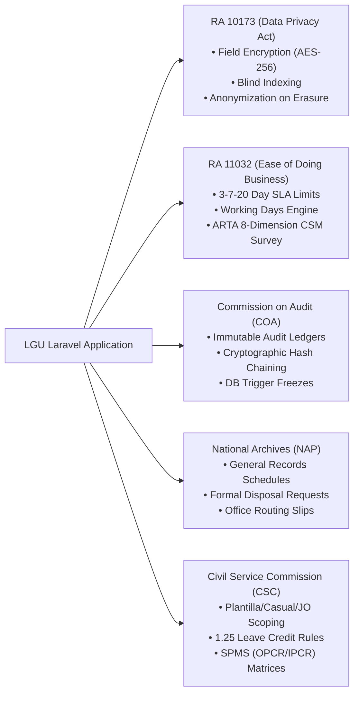

# LGU Laravel GovSuite & Engineering Standards

Official software development protocols, architecture traits, AI compliance auditor, and governance standards for the Local Government Unit (LGU).

**Issuing Authority:** Information and Communications Technology Office (ICTO), Municipality of Bayambang  
**Contact:** `icto@bayambang.gov.ph`  
**License:** [Apache 2.0](LICENSE) | **Security Policy:** [SECURITY.md](SECURITY.md)

---

## 🏛️ Package Overview

`lgu-bayambang-ict-office/lgu-laravel-development-standards` is a turnkey Laravel Composer package that equips internal municipal engineering teams, contractual developers, and third-party software vendors with:
* **Statutory Compliance Engines:** Built-in support for DPA RA 10173 (at-rest AES-256 field encryption & blind indexing), ARTA RA 11032 (3-7-20 working days SLA engine with holiday skipping), and COA Circulars (cryptographic SHA-256 hash chaining).
* **Enterprise Architecture Traits & Middleware:** Dual-Identifier Standard (`BIGINT id` PK + UUID route binding), fail-closed multi-office scoping (`OfficeScope`), and municipal workstation hardening.
* **AI Coding Agent Rules & Prompts:** Drop-in compliance guides for Google Antigravity, Cursor, Claude Code, and GitHub Copilot.
* **Automated Compliance Auditor CLI:** `php artisan lgu:audit` to programmatically detect non-compliant patterns in CI/CD or local development.

---

## 📦 Installation & Setup

Install the package via Composer:

```bash
composer require lgu-bayambang-ict-office/lgu-laravel-development-standards
```

### 1. Interactive Asset Scaffolding
Run the interactive installer to publish configuration, AI rules, code style presets, and documentation:

```bash
php artisan lgu:install
```

Or publish all assets without prompts:
```bash
php artisan lgu:install --all
```

Published tags available:
* `--tag=lgu-config`: Publishes `config/lgu.php`
* `--tag=lgu-dev-tools`: Publishes `pint.json` and `phpstan.neon` (Level 5 preset) to project root
* `--tag=lgu-ai-rules`: Publishes `.cursorrules`, `CLAUDE.md`, `.gemini/rules/lgu.md`, and `.github/copilot-instructions.md`
* `--tag=lgu-docs`: Publishes `docs/LARAVEL_LGU_DEVELOPMENT_STANDARDS.md` and `docs/VENDOR_DELIVERY_CHECKLIST.md`
* `--tag=lgu-migrations`: Publishes COA audit ledger table migrations and database triggers
* `--tag=lgu-stubs`: Publishes customizable traits, casts, scopes, and middleware directly to `app/`

---

## 🤖 AI Compliance Audit Guide

This package transforms your municipal engineering standards into an active **AI Compliance Auditor** inside your team's IDEs and CI/CD pipelines.

### How Developers Prompt Their AI Agents:
Developers working in Antigravity, Cursor, or Claude Code can simply prompt:
> *"Audit my newly implemented module against `docs/LARAVEL_LGU_DEVELOPMENT_STANDARDS.md` and complete `docs/VENDOR_DELIVERY_CHECKLIST.md`."*

Because the package publishes local AI instruction files (`.cursorrules`, `CLAUDE.md`, `.gemini/rules/lgu.md`), AI agents automatically enforce:
1. **Dedicated Show Routes:** No monolithic Livewire modals for viewing records.
2. **Dual-Identifier Standard:** Models must implement `HasRouteUuid`.
3. **Data Privacy (RA 10173):** Sensitive personal information must use `EncryptedPii` and blind indexing.
4. **Policy-Mediated RBAC:** Zero hardcoded `$user->hasRole(...)` or `@role(...)`; checks must route through native Policies and `$user->can()`.
5. **Event Safety:** Transactional events must declare `public bool $afterCommit = true`.

### Programmatic Auditor CLI:
Run the built-in auditor to scan your models, controllers, views, and policies:

```bash
# Standard CLI table output
php artisan lgu:audit

# JSON output for CI/CD pipelines or AI agent parsing
php artisan lgu:audit --format=json

# Markdown output for GitHub Pull Request summaries
php artisan lgu:audit --format=markdown

# Strict mode: Treat warnings as errors
php artisan lgu:audit --strict
```

---

## 📁 Key Governance Documents

* **[LARAVEL_LGU_DEVELOPMENT_STANDARDS.md](LARAVEL_LGU_DEVELOPMENT_STANDARDS.md)**: Master handbook (17 sections) covering MVC vs. Livewire, Actions/Services, `.env` vs. DB settings, Universal Naming Conventions Matrix, Gates & Policies, and disaster recovery.
* **[VENDOR_DELIVERY_CHECKLIST.md](VENDOR_DELIVERY_CHECKLIST.md)**: Procurement and handover acceptance checklist.
* **[pint.json](pint.json)**: Mandated Laravel Pint code style rules.
* **[phpstan.neon](phpstan.neon)**: Mandated Larastan Level 5 static analysis configuration.

---

## 🛠️ Direct Reusable Classes (`Lgu\GovSuite\...`)

You can directly use the package classes in your application without copying stubs:

```php
use Lgu\GovSuite\Traits\HasRouteUuid;
use Lgu\GovSuite\Traits\HasPiiHashing;
use Lgu\GovSuite\Traits\BelongsToOffice;
use Lgu\GovSuite\Casts\EncryptedPii;
use Lgu\GovSuite\Services\WorkingDaysService;
use Lgu\GovSuite\Policies\BaseGovernmentPolicy;
use Lgu\GovSuite\Middleware\PreventBackHistoryCache;
use Lgu\GovSuite\Middleware\EnforceSessionTimeout;
use Lgu\GovSuite\Middleware\RequireOfficeSelection;
```

---

## ⚖️ Statutory Compliance Matrix



---

## 🚀 Acceptance Verification Workflow

Every application delivered to the LGU must pass all automated verification gates:

```bash
# 1. Run automated test suite (Pest PHP)
php artisan test

# 2. Check code styling against LGU Pint preset
./vendor/bin/pint --test

# 3. Perform static type analysis (Level 5)
./vendor/bin/phpstan analyse

# 4. Run LGU statutory compliance auditor
php artisan lgu:audit --strict

# 5. Verify database migration reversibility & deterministic seeding
php artisan migrate:fresh --seed
```

---

## ⚖️ Legal, Trademark & Statutory Notices

### 1. License (Apache License 2.0)
This suite is licensed under the **Apache License, Version 2.0**. You may freely use, reproduce, modify, merge, and distribute this software in commercial, public sector, and proprietary applications, subject to the conditions of the license.

### 2. Trademark & Municipal Seal Reservation
Under **Section 6 of the Apache License 2.0**, this license **does not** grant permission to use the trade names, trademarks, service marks, or official municipal seals of the Licensor. The names "Municipality of Bayambang", "Bayambang ICTO", and official municipal crests may not be used to endorse or promote products derived from this software without prior written permission.

### 3. Statutory Legal Disclaimer
This package provides software architecture patterns, technical components, and heuristic auditing tools designed to assist engineering teams in aligning with Republic Act No. 10173 (Data Privacy Act of 2012), Republic Act No. 11032 (Ease of Doing Business Act of 2018), and Commission on Audit (COA) Circulars.  

This software and its documentation **do not constitute formal legal counsel** or statutory certification from the National Privacy Commission (NPC), the Anti-Red Tape Authority (ARTA), or the Commission on Audit (COA). Implementing agencies and third-party software contractors remain solely responsible for conducting their own independent security audits and institutional legal reviews.

---
**Maintained & Engineered by:**  
**Information and Communications Technology Office (ICTO)**  
Municipality of Bayambang  
Contact: `icto@bayambang.gov.ph`  

*Approved and Issued by the Information and Communications Technology Office (ICTO), Municipality of Bayambang.*
