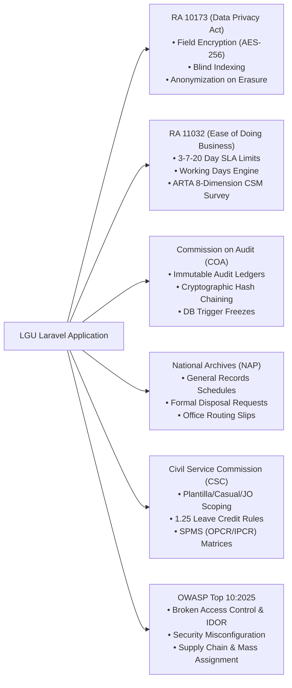

# LGU Laravel GovSuite & Engineering Standards

Official software development protocols, architecture traits, AI compliance auditor, and governance standards for the Local Government Unit (LGU).

**Issuing Authority:** Information and Communications Technology Office (ICTO), Municipality of Bayambang  
**Contact:** `icto@bayambang.gov.ph`  
**License:** [Apache 2.0](LICENSE) | **Security Policy:** [SECURITY.md](SECURITY.md) | **Contributing:** [CONTRIBUTING.md](CONTRIBUTING.md)

---

## 🏛️ Package Overview

`lgu-bayambang-ict-office/lgu-laravel-development-standards` is a turnkey Laravel Composer package that equips internal municipal engineering teams, contractual developers, and third-party software vendors with:
* **Statutory Compliance Engines:** Built-in support for DPA RA 10173 (at-rest AES-256 field encryption & blind indexing), ARTA RA 11032 (3-7-20 working days SLA engine with holiday skipping), and COA Circulars (cryptographic SHA-256 hash chaining).
* **Enterprise Architecture Traits & Middleware:** Dual-Identifier Standard (`BIGINT id` PK + UUID route binding), fail-closed multi-office scoping (`OfficeScope`), and municipal workstation hardening.
* **AI Coding Agent Directives & Rules:** Drop-in compliance instructions for Google Antigravity, Cursor, Claude Code, and GitHub Copilot (`AGENTS.md`, `.cursorrules`, `CLAUDE.md`, `.gemini/rules/lgu.md`).
* **Automated Compliance Auditor CLI:** `php artisan lgu:audit` to programmatically detect non-compliant patterns in CI/CD or local development with decoupled OWASP Top 10:2025 security invariants and exportable Markdown/JSON audit reports.
* **National Privacy Commission (NPC) Synchronizer CLI:** `php artisan lgu:npc-sync` to fetch active National Privacy Commission circulars from `privacy.gov.ph` and systematically assess project-specific DPA applicability.
* **Production Hosting Blueprints:** Hardening and deployment blueprints for CloudPanel (Nginx, PHP 8.x, Redis) and Cloudflare Free Tier (WAF, SSL/TLS Full/Strict, Rate Limiting, HTTP/3).

---

## 📦 Installation & Setup

Install the package via Composer:

```bash
composer require lgu-bayambang-ict-office/lgu-laravel-development-standards
```

### 1. Interactive Asset Scaffolding
Run the interactive installer to publish configuration, AI rules, code style presets, and documentation:

```bash
php artisan lgu:install
```

Or publish all assets without prompts:
```bash
php artisan lgu:install --all
```

Published tags available:
* `--tag=lgu-config`: Publishes `config/lgu.php`
* `--tag=lgu-dev-tools`: Publishes `pint.json` and `phpstan.neon` (Level 5 preset) to project root
* `--tag=lgu-ai-rules`: Publishes `.cursorrules`, `CLAUDE.md`, `.gemini/rules/lgu.md`, and `.github/copilot-instructions.md`
* `--tag=lgu-ai-skills`: Publishes autonomous AI agent skills suite to `.agents/skills/` (`lgu-code-author`, `lgu-audit-reviewer`, `lgu-standards-maintainer`)
* `--tag=lgu-docs`: Publishes `docs/LARAVEL_LGU_DEVELOPMENT_STANDARDS.md` and `docs/VENDOR_DELIVERY_CHECKLIST.md`
* `--tag=lgu-migrations`: Publishes COA audit ledger table migrations and database triggers
* `--tag=lgu-stubs`: Publishes customizable traits, casts, scopes, and middleware directly to `app/`

To install the AI skills suite directly:
```bash
php artisan lgu:install --ai-skills
```

---

## 🧠 Autonomous AI Agent Skills Suite (`.agents/skills/`)

Beyond passive rule files, the package bundles three specialized agent skills that operate natively with **Laravel Boost** and the **Model Context Protocol (MCP)**:

| Skill | Role | Key Capabilities |
| :--- | :--- | :--- |
| **`lgu-code-author`** | **Code Generation** | Scaffolds compliant migrations (Dual-ID `BIGINT id` + UUID), models with `EncryptedPii` + blind index, Action/Service boundaries, `afterCommit` listeners, and dedicated MVC show routes. |
| **`lgu-audit-reviewer`** | **Audit & Reporting** | Executes compliance audits via MCP or CLI, conducts semantic inspection of flagged files, and produces executive Markdown audit reports with ready-to-apply code replacement diffs. |
| **`lgu-standards-maintainer`** | **Regulatory Curation** | Autonomous research and update flow for future OWASP Top 10 releases and NPC Data Privacy circulars, updating mapping matrices and seed catalogs without manual intervention. |

```
┌────────────────────────────────────────────────────────────────────────┐
│                        AI AGENT EXECUTION FLOW                         │
├────────────────────────────────────────────────────────────────────────┤
│ 1. Developer prompts Agent ("Audit module" / "Build Citizen Permit")   │
│ 2. Agent invokes Skill (lgu-code-author or lgu-audit-reviewer)         │
│ 3. Agent leverages Laravel Boost / MCP (execute_artisan, get_routes)   │
│ 4. Fallback: Agent inspects source files directly (Zero PHP runtime)   │
│ 5. Agent outputs compliant code or executive Markdown audit report     │
└────────────────────────────────────────────────────────────────────────┘
```

---

## 🤖 AI Compliance Audit Guide

This package transforms your municipal engineering standards into an active **AI Compliance Auditor** inside your team's IDEs and CI/CD pipelines.

### How Developers Prompt Their AI Agents:
Developers working in Antigravity, Cursor, or Claude Code can simply prompt:
> *"Audit my newly implemented module against `docs/LARAVEL_LGU_DEVELOPMENT_STANDARDS.md` and complete `docs/VENDOR_DELIVERY_CHECKLIST.md`."*

Because the package publishes local AI instruction files (`AGENTS.md`, `.cursorrules`, `CLAUDE.md`, `.gemini/rules/lgu.md`), AI agents automatically enforce:
1. **Dedicated Show Routes:** No monolithic Livewire modals for viewing records.
2. **Dual-Identifier Standard:** Models must implement `HasRouteUuid`.
3. **Data Privacy (RA 10173):** Sensitive personal information must use `EncryptedPii` and blind indexing.
4. **Policy-Mediated RBAC:** Zero hardcoded `$user->hasRole(...)` or `@role(...)`; checks must route through native Policies and `$user->can()`.
5. **Event Safety:** Transactional events must declare `public bool $afterCommit = true`.

### Programmatic Auditor CLI (`php artisan lgu:audit`):
Run the built-in auditor to scan your models, controllers, views, policies, and environment configurations against Philippine statutory standards and decoupled OWASP Top 10 security invariants:

```bash
# Standard CLI table output with immediate scope reminder banner
php artisan lgu:audit

# Inline statutory remediation directives for non-compliant findings
php artisan lgu:audit --fix-hint

# Generate and save comprehensive audit report (Markdown or JSON)
php artisan lgu:audit --output # Saves to storage/app/lgu/audit-report.md
php artisan lgu:audit --format=json --output # Saves to storage/app/lgu/audit-report.json
php artisan lgu:audit --output=reports/acceptance-audit.md # Custom destination path

# Project onto OWASP Top 10:2021 framework version (defaults to 2025)
php artisan lgu:audit --owasp-version=2021

# Strict mode: Treat warnings as failures (recommended for CI/CD gates)
php artisan lgu:audit --strict --output
```

> [!IMPORTANT]
> **Audit Scope & Limitations Disclaimer:**  
> The `lgu:audit` command evaluates **technical architecture conventions, statutory engineering controls (DPA RA 10173, ARTA RA 11032, COA ledgers), and OWASP security baseline invariants**. It **does NOT** audit application business domain correctness, user acceptance criteria (UAT), or functional requirements specified in project Terms of Reference (TOR). Functional completeness and business workflow logic must be verified independently through automated test suites (`php artisan test`) and stakeholder User Acceptance Testing (UAT).

#### Audit Report Breakdown (`--output`):
When `--output` is passed, the generated report includes:
1. **Philippine Statutory & Governance Checklist:** Explicit status for DPA field encryption, ARTA SLA compliance, COA hash chaining, and workstation session security.
2. **Decoupled OWASP Top 10 Assessment:** Category-by-category security breakdown with dual-track remediation:
   - **Code Remediation:** Specific Laravel-native fixes (Form Requests, Policies, Strict Eloquent, Encrypted Casts).
   - **Hosting Infrastructure Action:** Concrete configuration rules for CloudPanel and Cloudflare.
3. **Statutory vs. OWASP Reconciliations:** Resolution matrices for compliance tensions (e.g., COA immutable ledgers vs. DPA Right to Erasure / GDPR-style deletion).
4. **CloudPanel & Cloudflare Free Tier Blueprints:** Ready-to-apply Nginx fastcgi/headers snippets, Cloudflare WAF expression rules, and Redis security directives.
5. **NPC Issuance Inventory:** Active circulars and advisories evaluated for the application.

---

## 🇵🇭 National Privacy Commission (NPC) Synchronizer CLI (`php artisan lgu:npc-sync`)

The `lgu:npc-sync` command enables engineering teams to synchronize official NPC circulars and advisories directly from `privacy.gov.ph` and systematically assess their applicability to the system:

```bash
# Interactive synchronization and applicability assessment
php artisan lgu:npc-sync

# Refresh local catalog cache without interactive prompts (CI/CD safe)
php artisan lgu:npc-sync --fetch-only

# Re-evaluate all issuances (including previously reviewed items)
php artisan lgu:npc-sync --re-review

# Fetch from a custom URL
php artisan lgu:npc-sync --url=https://privacy.gov.ph/advisories-circulars/
```

* **Live Scraping & Offline Fallback:** Synchronizes canonical circulars and advisories from `https://privacy.gov.ph/advisories-circulars/`. If the NPC portal is unreachable, it automatically falls back to the package's bundled verified seed catalog (`resources/data/npc-catalog-seed.json`).
* **Interactive Assessment:** Prompts developers for each active issuance (e.g., Data Breach Management, Cloud Computing Guidelines, Security of Personal Data) and records applicability and developer rationale in `storage/app/lgu/npc-assessment.json`.
* **Integrated Audit Reporting:** Results are automatically ingested into `php artisan lgu:audit` and included in generated audit reports.

---

## 📁 Key Governance Documents

* **[AGENTS.md](AGENTS.md)**: Universal AI Coding Agent guidelines and operational protocols for Antigravity, Cursor, Claude Code, and Copilot.
* **[LARAVEL_LGU_DEVELOPMENT_STANDARDS.md](LARAVEL_LGU_DEVELOPMENT_STANDARDS.md)**: Master handbook (17 sections) covering MVC vs. Livewire, Actions/Services, `.env` vs. DB settings, Universal Naming Conventions Matrix, Gates & Policies, and disaster recovery.
* **[VENDOR_DELIVERY_CHECKLIST.md](VENDOR_DELIVERY_CHECKLIST.md)**: Procurement and handover acceptance checklist.
* **[pint.json](pint.json)**: Mandated Laravel Pint code style rules.
* **[phpstan.neon](phpstan.neon)**: Mandated Larastan Level 5 static analysis configuration.

---

## 🛠️ Direct Reusable Classes (`Lgu\GovSuite\...`)

You can directly use the package classes in your application without copying stubs:

```php
use Lgu\GovSuite\Traits\HasRouteUuid;
use Lgu\GovSuite\Traits\HasPiiHashing;
use Lgu\GovSuite\Traits\BelongsToOffice;
use Lgu\GovSuite\Casts\EncryptedPii;
use Lgu\GovSuite\Services\WorkingDaysService;
use Lgu\GovSuite\Services\NpcCatalogService;
use Lgu\GovSuite\Security\SecurityStandardsMapper;
use Lgu\GovSuite\Policies\BaseGovernmentPolicy;
use Lgu\GovSuite\Middleware\PreventBackHistoryCache;
use Lgu\GovSuite\Middleware\EnforceSessionTimeout;
use Lgu\GovSuite\Middleware\RequireOfficeSelection;
```

---

## ⚖️ Statutory Compliance Matrix



---

## 🚀 Acceptance Verification Workflow

Every application delivered to the LGU must pass all automated verification gates:

```bash
# 1. Run automated test suite (Pest PHP)
php artisan test

# 2. Check code styling against LGU Pint preset
./vendor/bin/pint --test

# 3. Perform static type analysis (Level 5)
./vendor/bin/phpstan analyse

# 4. Run dependency security audit
composer audit

# 5. Synchronize & assess National Privacy Commission (NPC) circulars
php artisan lgu:npc-sync

# 6. Run LGU statutory & OWASP Top 10 compliance auditor (decoupled invariant rules)
php artisan lgu:audit --strict --output # Enforces OWASP Top 10:2025; saves report to storage/app/lgu/audit-report.md

# 7. Verify database migration reversibility & deterministic seeding
php artisan migrate:fresh --seed
```

---

## 🤝 Contributing & Pull Requests

We welcome pull requests from public sector developers, IT teams, vendor contractors, and the open-source community to improve statutory alignment, code quality, and developer tooling.

Before submitting code, please review our **[CONTRIBUTING.md](CONTRIBUTING.md)** for:
* Development environment setup and automated quality gates (`pint`, `phpunit`, `phpstan`)
* Philippine statutory guidelines (RA 10173 DPA, RA 11032 ARTA, COA Circulars)
* Conventional commit message conventions and PR submission checklist

> [!NOTE]
> Suspected security vulnerabilities should never be submitted via public PRs or issues. Please consult **[SECURITY.md](SECURITY.md)** for confidential disclosure channels.

---

## ⚖️ Legal, Trademark & Statutory Notices

### 1. License (Apache License 2.0)
This suite is licensed under the **Apache License, Version 2.0**. You may freely use, reproduce, modify, merge, and distribute this software in commercial, public sector, and proprietary applications, subject to the conditions of the license.

### 2. Trademark & Municipal Seal Reservation
Under **Section 6 of the Apache License 2.0**, this license **does not** grant permission to use the trade names, trademarks, service marks, or official municipal seals of the Licensor. The names "Municipality of Bayambang", "Bayambang ICTO", and official municipal crests may not be used to endorse or promote products derived from this software without prior written permission.

### 3. Statutory Legal Disclaimer
This package provides software architecture patterns, technical components, and heuristic auditing tools designed to assist engineering teams in aligning with Republic Act No. 10173 (Data Privacy Act of 2012), Republic Act No. 11032 (Ease of Doing Business Act of 2018), and Commission on Audit (COA) Circulars.  

This software and its documentation **do not constitute formal legal counsel** or statutory certification from the National Privacy Commission (NPC), the Anti-Red Tape Authority (ARTA), or the Commission on Audit (COA). Implementing agencies and third-party software contractors remain solely responsible for conducting their own independent security audits and institutional legal reviews.

---
**Maintained & Engineered by:**  
**Information and Communications Technology Office (ICTO)**  
Municipality of Bayambang  
Contact: `icto@bayambang.gov.ph`  

*Approved and Issued by the Information and Communications Technology Office (ICTO), Municipality of Bayambang.*
